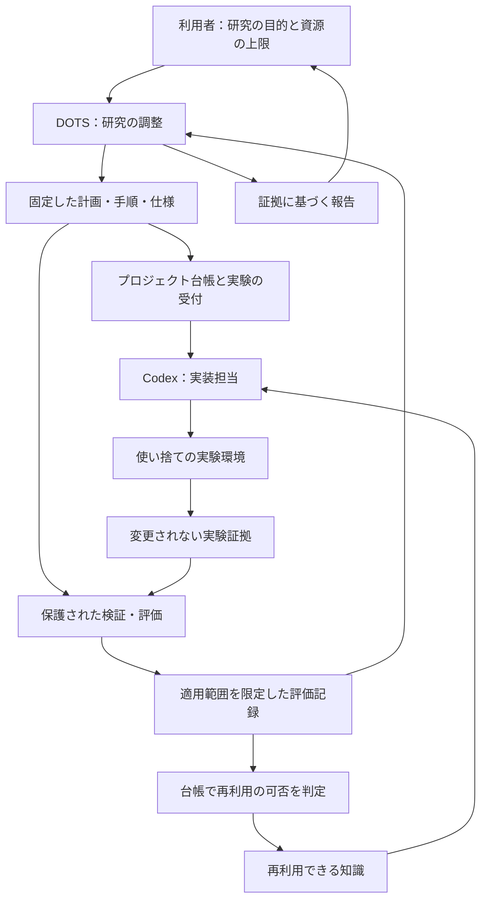

# AI Agent Scientist

日本語 | [English](README.md)

既存のChatGPTとCodexを使って、研究の問いを検証可能な仮説にし、再現できる実験を経て、証拠に基づく結論につなげる **DOTS中心の研究支援基盤の設計**です。

**現在地：** 設計文書と、オフラインで動くPythonの補助機能があります。研究システム全体の稼働やライブ連携は、受入検証が済んでいません。

## 全体構成

以下は**目標とする構成**で、配備済みサービスの図ではありません。DOTSが研究を調整し、Codexが範囲を限定した実装を担当します。候補を作る側は、評価、権限、予算、知識の再利用可否を決められません。

MCPは任意の接続方法です。実験が完了したか、証拠が妥当か、科学的な価値があるかは別々に判断します。非公開データや最終評価の正解は公開物に含めません。

## 目的別リンク

| やりたいこと | 読むもの |
|---|---|
| 全体を理解する | [構成](docs/03-architecture.ja.md)、[研究の流れ](docs/04-research-workflow.ja.md)、[ロードマップ](docs/10-roadmap.ja.md) |
| 実験を計画し、記録する | [研究概要](templates/research-brief.ja.md)、[実験計画](templates/experiment-plan.ja.md)、[実行レポート](templates/run-report.ja.md) |
| 結果の検証方法を知る | [実施手順と受入基準](docs/12-protocol-and-acceptance.ja.md)、[評価](docs/07-evaluation.ja.md)、[検証と知識の再利用](docs/13-verified-discovery.ja.md) |
| オフライン実装を確認する | [ソース](src/ai_agent_scientist/)、[契約テスト](tests/contracts/)、[スキーマ](schemas/README.ja.md)、[合成データの例](examples/) |
| Kaggleで使う構想を見る | [コンペ向け設計と提出の境界](docs/15-kaggle-competitions.ja.md) |

## オフラインで実装済みの範囲

予算の事前計算、バイト列の変更不能な保存、引継ぎのチェックと受領記録、予約・使用量の記録、復旧用の情報表示、実験証拠の取り込みがあります。**実行許可やジョブの配信、精算、認証、実行環境の隔離までを実現したものではありません。**

[既存の実験結果の取り込み](docs/38-existing-run-import.ja.md)には合成データでの検証記録があります。[パスを指定する取り込み](docs/39-intake-summary.ja.md)はコード作成済みで、設計文書では検査待ちです。どちらも実モデルやWindows／WSLでの受入検証は未確認です。取り込みに必要なファイルシステム機能はWindowsネイティブではサポートされません。

Draft 2020-12対応の `jsonschema` がある環境で `python scripts/check_design.py` を実行できます。[検査範囲](scripts/README.ja.md)は文書とスキーマの整合性で、実運用の動作を保証するものではありません。

[すべての文書](docs/) · [旧READMEと検証履歴](https://github.com/moruku36/ai-agent-scientist/blob/757ef66298720dadc93fd9c39fcf1664503523f7/README.ja.md)
