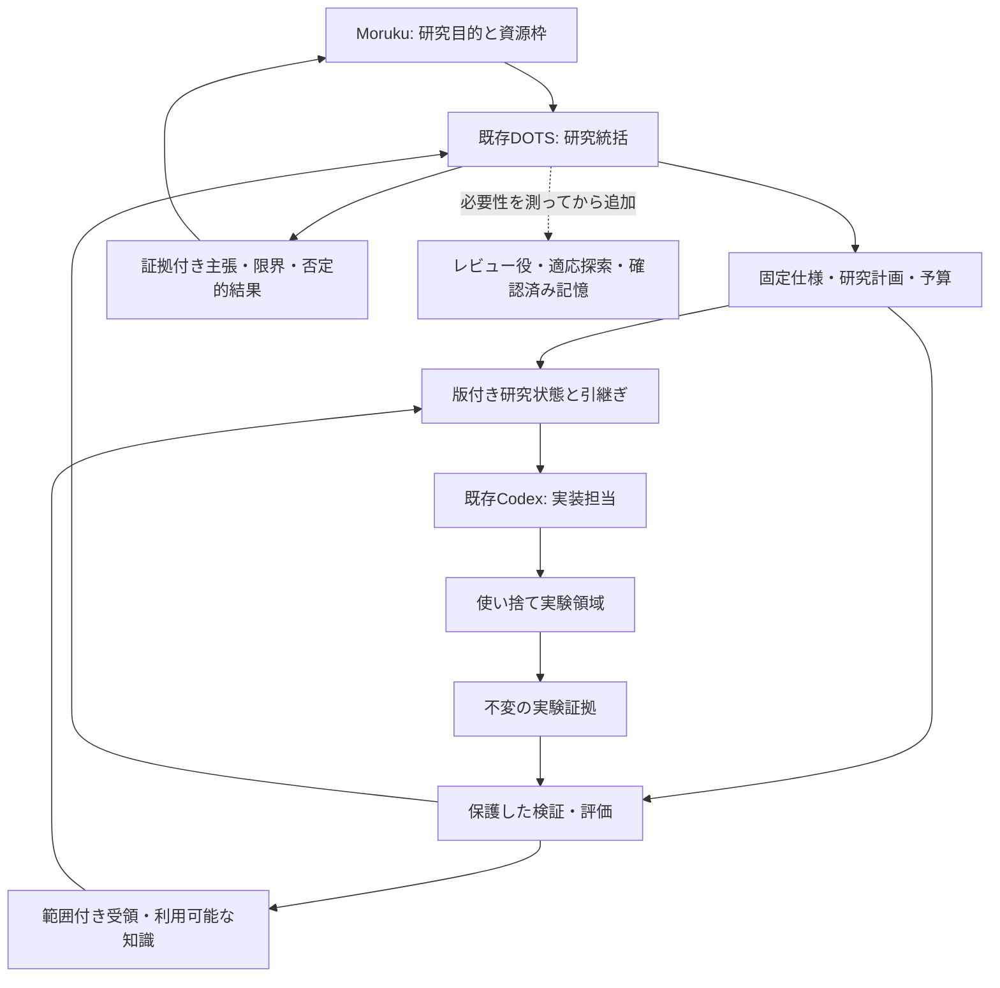

# AI Agent Scientist

日本語 | [English](README.md)

**DOTSを中心に、今使っているChatGPT／Codexで、研究の問いを「検証可能な仮説→再現可能な実験→証拠付きの結論」へ進める研究ハーネスです。**

DOTSが研究を統括し、Codexが実装・上限付き実験を担当します。会話の外に事実を残し、固定仕様・保護した検証・範囲を明示した知識再利用で、候補と証拠を結びます。目的は研究を前進させることであり、論文の体裁やAI査読点だけを成果にしません。

**2026-11-11 JSTに改訂した詳細設計です。** ランタイム実装、DOTS接続、実験、有料API／GPU利用、性能改善の実測は行っていません。設定例も無効です。

## 今の環境への合わせ方

- 既存のDOTS・ChatGPT／Codexを使う。新しいエージェント基盤や契約を前提にしない。
- 研究1件、実装ワーカー1つ、CPU実験から始める。
- 接続確認済みのPC上に専用の使い捨て作業領域を設ける。NUCの既存サービスや隔離セキュリティVMを、そのまま実験場にしない。
- 正本は会話記憶の外へ置き、新しい作業には版付きの短い引継ぎを渡す。
- 既存のエージェント間通信やsleep／memoryは、個別の受入が必要な任意の接続先とする。

[環境と前提](docs/01-environment.ja.md)で、記録された観測・予定配置・未確認を分けています。

## 全体像

ハーネスは、既存エージェントを支える状態・実験・評価の仕組みです。MCPは接続方式の候補で、ハーネス全体を意味しません。

## 7件の研究の使い方

| 研究 | 今回の取り込み |
|---|---|
| The AI Scientist | アイデア・実装・実験・執筆を接続し、各段階で確認 |
| 自律ML開発と簡素なハーネス | 道具を持つ単一ワーカーを基準にし、複雑化の費用対効果を測る |
| 自由なAI研究の評価 | 実装完了と研究上の貢献を別々に判定 |
| Evolving Agent Teams | 停滞原因を診断し、必要な役割だけを変更 |
| Darwin Gödel Machine | 候補と系譜を保存し、候補が変更できない評価で比較 |
| AB-MCTS | 将来、候補を広げる／深める配分を固定予算で比較 |
| Discovering formally verified quantum programs with AI | [仕様・検証・知識再利用](docs/13-verified-discovery.ja.md)を取り込み、実証研究へ形式証明を一律必須化しない |

[研究対応表](docs/02-research-foundations.ja.md)に一次資料、保存済みノート、限界を掲載。組合せは今回の独自設計であり、7件がこの完成形の有効性を実証したわけではありません。

## 設計資料

| 文書 | 内容 |
|---|---|
| [01 環境](docs/01-environment.ja.md) | 現行環境、制約、未確認 |
| [02 研究の下地](docs/02-research-foundations.ja.md) | 7資料と採用する仕組み |
| [03 全体構成](docs/03-architecture.ja.md) | 要素・配置・保存・権限境界 |
| [04 研究の進め方](docs/04-research-workflow.ja.md) | 状態、仮説、予算、終了条件 |
| [05 DOTS接続](docs/05-dots-integration.ja.md) | 引継ぎ、通信、MCP、復旧 |
| [06 実験契約](docs/06-experiment-contracts.ja.md) | 計画、識別、資源、データ、証拠 |
| [07 評価](docs/07-evaluation.ja.md) | 評価の保護、再現性、研究妥当性 |
| [08 適応的な改善](docs/08-adaptive-improvement.ja.md) | DGM／AB-MCTS／EAT由来の任意拡張 |
| [09 安全性と公開](docs/09-safety-publication.ja.md) | 許可内の自律進行、非公開証拠、公開成果 |
| [10 実装計画](docs/10-roadmap.ja.md) | 作業単位、受入条件、最初の実験 |
| [11 ハーネス境界](docs/11-harness-boundaries.ja.md) | 正本の分担、任意の参照型受け渡し |
| [12 計画と受入](docs/12-protocol-and-acceptance.ja.md) | 固定した研究比較、SCI-01〜12 |
| [13 検証を中心とする発見](docs/13-verified-discovery.ja.md) | 仕様の依存全体、検証adapter、知識採用、SCI-13〜20 |

[研究ブリーフ](templates/research-brief.ja.md)、[実験計画](templates/experiment-plan.ja.md)、[実験レポート](templates/run-report.ja.md)を雛形として使います。[無効のCPU設定例](examples/cpu-pilot.json)と[DOTSへの引継ぎ例](examples/dots-handoff.ja.md)も用意しました。

最初は **ブリーフ→基準実装→候補→反復可能な評価→証拠付き報告→終了処理** を一周させます。今回、定期実行や他エージェントへの依頼は作成しません。

## 設計引継ぎ更新 — 2026-11-09

実装前に[実装契約と受入ケース](docs/12-protocol-and-acceptance.ja.md)を読む。この更新は状態の正本、不変の証拠、再送・復旧、評価境界を具体化し、設計schemaと合成例だけを追加する。実装は別のAIによる後続変更で行う。性能結果や実接続は主張しない。

三つのrepoはそれぞれ単独で使える設計を維持。任意接続は[参照型の受け渡し契約](https://github.com/moruku36/ai-agent-scientist/blob/main/docs/11-harness-boundaries.ja.md)に従い、権限の共有や新agent runtimeを作らない。

## 検証を中心とする改訂 — 2026-11-11

[今回の設計](docs/13-verified-discovery.ja.md)は既存の評価境界を拡張し、DOTSや単一ワーカーを置き換えません。候補は仕様の依存定義を変更したり、自己申告で主張を採用したりできません。実証検査・形式証明・再現・科学的貢献を分け、確認済み部品とレビュー済み案に異なる再利用条件を設け、最終評価の答えを調整用知識へ混ぜません。

検証契約と無効な合成例を追加し、既存の計画・受け渡しschema版は維持。[オフライン設計検査](scripts/README.ja.md)の成功は実行時受入ではありません。実装は上限付きCPU一周から始め、形式検証器は適した課題向けの後続選択肢です。
