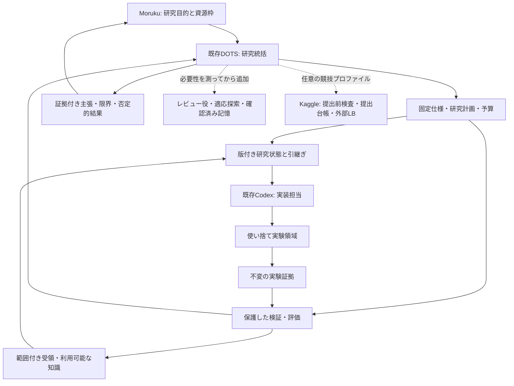

# AI Agent Scientist

> 増分28のcoordinator検査：最初の6メソッドは5成功・F04のfixtureエラー1件で、不変eventの削除が正しく拒否されました。file-onlyテスト修正でtrusted API外の旧形式event欠落を模し、唯一の対象再検査でF01–F06の6件すべて成功（0.050秒）。既存環境の設計checkerは1回成功（620リンク・36言語pair）、空白検査も成功。以下の未実行／保留はworker作成時点で後続検査ではありません。独立レビューは別途記録し、runtime受入ではありません。

**復旧report増分28（2026-11-17）：作成済み・未実行（NOT EXECUTED）。** [上限付き決定的な非公開復旧report](docs/28-recovery-report.ja.md)は3番目の接続offline増分です。実triageの1ページを選択JSONの不変bytes・厳密バイトSHA-256・cursor metadataへ接続し、バイト超過時は全artifactを拒否します。新規の自己完結テストを正確に6つと日英文書を作成済みです。増分28の全検査は保留で、過去のcoordinator bannerは過去の増分だけが対象です。証明・復旧権限・自動公開exportはありません。

> 増分27のcoordinator検査：新規T01–T06の6メソッドが1回offline成功（0.045秒）。既存環境の設計checkerは1回成功（594リンク・35言語pair）、空白検査も成功。以下の未実行／保留はworker作成時点の履歴で、このcoordinator結果ではありません。独立レビューは別途記録し、runtime受入ではありません。

**復旧triage増分27（2026-11-17）：ソース・新規の自己完結テストを正確に6つ・日英文書を作成済み、未実行（NOT EXECUTED）。** [保守的な受信者ローカル復旧triage](docs/27-recovery-triage.ja.md)は2番目の接続offline増分です。実際の予約検査snapshotを上限付きreason viewへ接続し、完全な予約を保持します。受付・readiness・dispatch・settlement権限はありません。coordinator検査は保留中で、過去の検証bannerはこの増分を対象にしません。

> Coordinator検証（2026-11-17）：新規I01–I06の6メソッドが1回offline成功（0.039秒）。既存環境の設計checkerは1回成功（564リンク・34言語pair）、空白検査も成功。固定sourceの独立全体レビューで記載の信頼前提内の実装欠陥はなし。以下の未実行／保留はworkerのfile-only作成時点で、後続coordinator検査ではありません。runtime受入ではありません。

> Coordinator検証（2026-11-17、round3のみ）：新規U01〜U06の6シナリオが1回成功（1.183秒）、既存venvの設計checkerも1回成功（534リンク、33言語pair）。独立レビューは保留中です。以下の作成済み／未実行の文はworkerのfile-only作成時点の履歴で、現在のcoordinator検証状態ではありません。round2の元の生の検証出力は未入手で、round3からその検証を推測しません。

**outbox coordinator検証（2026-11-17）：O01〜O06はofflineで1回成功、0.046秒。必須設計checkerも1回成功（504 links、32言語pair）。元の選択workerは600秒timeout、task_complete／finalなし、完了UNKNOWN、再実行なし。以下の作成済み・未実行はworkerのみの活動履歴で、現在のcoordinator検証状態ではありません。live受入は主張しません。**

日本語 | [English](README.md)

**DOTSを中心に、今使っているChatGPT／Codexで、研究の問いを「検証可能な仮説→再現可能な実験→証拠付きの結論」へ進める研究ハーネスです。**

DOTSが研究を統括し、Codexが実装・上限付き実験を担当します。会話の外に事実を残し、固定仕様・保護した検証・範囲を明示した知識再利用で、候補と証拠を結びます。目的は研究を前進させることであり、論文の体裁やAI査読点だけを成果にしません。

**2026-11-16 JSTに改訂した詳細設計です。** 以下のオフライン補助（算術preflight・厳密バイトのblob保存・厳格なJSON blob読取・依頼preflight・payload束縛・ローカル永続受領とworker-seconds予約拡張）を除き、研究ランタイム実装、DOTS接続、実験、有料API／GPU利用、性能改善の実測は行っていません。設定例も無効です。6つ目の受領のみのシナリオは1回オフライン成功（1.172秒）です。予約拡張は実装済み、新規10シナリオが1回オフライン成功（0.082秒）です。

## 最初のオフライン実装 — 2026-11-17

[純粋なワーカー予算preflight](docs/17-budget-preflight.ja.md)でP1／SCI-05の算術部分のみを実装し、正本の10ケースが1回のオフライン実行で成功しました。受付・runner・認可・実研究runtimeではなく、残りの設計と無効の例は維持します。

## 2つ目のオフライン補助 — 2026-11-17

[不変の厳密バイトBlob補助](docs/18-immutable-blob-helper.ja.md)は、信頼できるローカルディレクトリで不透明なバイト列をSHA-256で保存・検証します（P1のハッシュ／保存の前提部品）。E01〜E12の12ケースがPython 3.15.2で1回のオフライン実行に成功しました。台帳・正規化（JCS）・認可・受領発行ではありません。

## 3つ目のオフライン補助 — 2026-11-17

[厳格なJSON blobリーダー](docs/19-json-blob-reader.ja.md)は、上限付き・ハッシュ検証済みのblob読取を、重複キーと非有限数を拒否するUTF-8 JSONデコードへ接続します。J01〜J08の8ケースがPython 3.15.2で1回オフライン成功。スキーマ検証・受付・JCS・台帳ではありません。

## 4つ目のオフライン補助 — 2026-11-17

[ハンドオフ依頼preflight](docs/20-handoff-request-preflight.ja.md)は、検証済み厳格JSON読取の後、依頼限定の固定構造と呼び出し側時計による有効期限を確認します。H01〜H08の8ケースがPython 3.15.2で1回オフライン成功。認証・認可・予約・ディスパッチは行いません。

## 5つ目のオフライン補助 — 2026-11-17

[ハンドオフpayload束縛](docs/21-handoff-payload-binding.ja.md)は、依頼preflight・現在の信頼するローカルmetadata／アクセス・上限付き検証済みpayload読取を合成します。実装済み、新規P01〜P10の10シナリオが1回オフライン成功（0.074秒）。coordinatorのソースレビュー完了。受付・dispatch権限は付与しません。

## 6つ目のオフライン補助 — 2026-11-17

[厳密バイト束縛の永続ハンドオフ受領](docs/22-durable-handoff-receipt.ja.md)は、毎回の依頼／payload検証を受信者所有のローカルSQLite保存と未解決CAS遷移1つへ接続します。実装済み、新規D01〜D10の10シナリオが1回オフライン成功（1.172秒）し、coordinatorのソースレビュー完了です。docs11の部分実装で元のenvelopeバイトを使い、全体の論理／JCS同一性は未実装です。元の`record` APIは受付・予約・dispatch権限を付与しません。

## ローカル予約の前提部品 — 2026-11-17

[transaction内の受信者ローカルstatus outbox](docs/24-local-status-outbox.ja.md)で、予約保持／照合eventとscope内ローカルack CASを追加しました。実装と新規offlineシナリオを正確に6つ作成済み、**未実行**です。sender・transport・遠隔配送・settlementは実装しません。

[ローカルworker-seconds予約の前提部品](docs/23-local-budget-reservation.ja.md)は、現在のcaller所有権限と固定共有envelopeを受領transactionへ接続します。実装済み、R01〜R10の10シナリオは1回オフライン成功（0.082秒）し、coordinatorの差分レビュー完了です。dispatchや完全な受付受入は提供しません。

[不変の受信者ローカルusage観測](docs/25-local-usage-observations.ja.md)（Scientist round3、独立source review済みround2 `bf4743970dc48e0e89e2717a2e07c2591c8db129`基点）は、trusted観測を既存予約・照合遷移・outboxと同じSQLite transactionへ接続します。実装と新規メソッドを正確に6つ作成済み、**未実行（NOT EXECUTED）**でcoordinator検査は保留中です。全予約を全量outstandingに保ち、settled floorを変更せず、usage／cleanupのUNKNOWNで予算をreleaseしません。観測保存のみで、settlement・計測・認証の主張はありません。

[受信者scope内の予約検査snapshot](docs/26-reservation-inspection.ja.md)は、保持済み受領・予約・現在のローカルoutbox状態・最後に挿入されたusage観測・固定allocation会計を単一読取transactionへ接続します。実装と新規の自己完結テストメソッドを正確に6つ作成済み、**未実行（NOT EXECUTED）**で、この増分の全検査は保留中です。この予約のallocation／全量outstandingだけを返し、共有合計やowner識別情報を含めません。3つの上限付きoffline増分の最初で、継続権限やsettlementを与えません。

## Kaggleコンペ対応 — 2026-11-16

[競技プロファイルと提出境界](docs/15-kaggle-competitions.ja.md)で、Kaggleを「主催者が評価器と最終評価を所有する研究課題」として既存設計へ接続。対象はGemma 4 Developer Agent、Name That LLM、Physical-Engineering's Last Examの3件です。ローカル評価を選択の根拠にし、Public LBは提出枠付きの外部フィードバック、提出・規則同意・公開は利用者の許可が要る外部行為として扱います。[知識とOSS候補](docs/16-kaggle-knowledge-oss.ja.md)は一覧であり、導入・検証はしていません。コンペへの参加、データ取得、学習、提出は行っていません。

## Sakana研究工程の統合 — 2026-11-14

[確認した方法論節に基づく設計](docs/14-sakana-lifecycle.ja.md)でAI Scientist v1／v2とThe Agentic Scientistを統合。読取専用着想、目的付き逐次探索、正しさ／rubric／選択の分離、固定候補の確認、生証拠付き報告を具体化します。DOTS・既存schema・検証済み知識を維持。全文・付録の完全読了、runtime、改善実測は主張しません。

## 今の環境への合わせ方

- 既存のDOTS・ChatGPT／Codexを使う。新しいエージェント基盤や契約を前提にしない。
- 研究1件、実装ワーカー1つ、CPU実験から始める。
- 接続確認済みのPC上に専用の使い捨て作業領域を設ける。NUCの既存サービスや隔離セキュリティVMを、そのまま実験場にしない。
- 正本は会話記憶の外へ置き、新しい作業には版付きの短い引継ぎを渡す。
- 既存のエージェント間通信やsleep／memoryは、個別の受入が必要な任意の接続先とする。

[環境と前提](docs/01-environment.ja.md)で、記録された観測・予定配置・未確認を分けています。

## 全体像

ハーネスは、既存エージェントを支える状態・実験・評価の仕組みです。MCPは接続方式の候補で、ハーネス全体を意味しません。

## 7件の研究の使い方

| 研究 | 今回の取り込み |
|---|---|
| The AI Scientist | アイデア・実装・実験・執筆を接続し、各段階で確認 |
| 自律ML開発と簡素なハーネス | 道具を持つ単一ワーカーを基準にし、複雑化の費用対効果を測る |
| 自由なAI研究の評価 | 実装完了と研究上の貢献を別々に判定 |
| Evolving Agent Teams | 停滞原因を診断し、必要な役割だけを変更 |
| Darwin Gödel Machine | 候補と系譜を保存し、候補が変更できない評価で比較 |
| AB-MCTS | 将来、候補を広げる／深める配分を固定予算で比較 |
| Discovering formally verified quantum programs with AI | [仕様・検証・知識再利用](docs/13-verified-discovery.ja.md)を取り込み、実証研究へ形式証明を一律必須化しない |

[研究対応表](docs/02-research-foundations.ja.md)に一次資料、保存済みノート、限界を掲載。組合せは今回の独自設計であり、7件がこの完成形の有効性を実証したわけではありません。

## 設計資料

| 文書 | 内容 |
|---|---|
| [01 環境](docs/01-environment.ja.md) | 現行環境、制約、未確認 |
| [02 研究の下地](docs/02-research-foundations.ja.md) | 7資料と採用する仕組み |
| [03 全体構成](docs/03-architecture.ja.md) | 要素・配置・保存・権限境界 |
| [04 研究の進め方](docs/04-research-workflow.ja.md) | 状態、仮説、予算、終了条件 |
| [05 DOTS接続](docs/05-dots-integration.ja.md) | 引継ぎ、通信、MCP、復旧 |
| [06 実験契約](docs/06-experiment-contracts.ja.md) | 計画、識別、資源、データ、証拠 |
| [07 評価](docs/07-evaluation.ja.md) | 評価の保護、再現性、研究妥当性 |
| [08 適応的な改善](docs/08-adaptive-improvement.ja.md) | DGM／AB-MCTS／EAT由来の任意拡張 |
| [09 安全性と公開](docs/09-safety-publication.ja.md) | 許可内の自律進行、非公開証拠、公開成果 |
| [10 実装計画](docs/10-roadmap.ja.md) | 作業単位、受入条件、最初の実験 |
| [11 ハーネス境界](docs/11-harness-boundaries.ja.md) | 正本の分担、任意の参照型受け渡し |
| [12 計画と受入](docs/12-protocol-and-acceptance.ja.md) | 固定した研究比較、SCI-01〜12 |
| [13 検証を中心とする発見](docs/13-verified-discovery.ja.md) | 仕様の依存全体、検証adapter、知識採用、SCI-13〜20 |
| [14 Sakana研究工程](docs/14-sakana-lifecycle.ja.md) | 着想・逐次探索・判定の分離・証拠付き報告 |
| [15 Kaggleコンペ対応](docs/15-kaggle-competitions.ja.md) | 3コンペの競技プロファイル、提出境界、KGL-01〜10 |
| [16 Kaggleの知識とOSS](docs/16-kaggle-knowledge-oss.ja.md) | 評価設計の知識、コンペ別の手法とOSS候補 |
| [17 予算preflight](docs/17-budget-preflight.ja.md) | 純粋算術を実装。10ケースが1回成功、受付ではない |
| [18 不変Blob補助](docs/18-immutable-blob-helper.ja.md) | 厳密バイトのローカルblob補助を実装。12ケースが1回成功、台帳ではない |
| [19 厳格なJSON blob読取](docs/19-json-blob-reader.ja.md) | 検証済みblobを厳格にデコード。8ケースが1回オフライン成功、レコード受理ではない |
| [20 ハンドオフ依頼preflight](docs/20-handoff-request-preflight.ja.md) | 依頼限定の構造・期限確認。8ケースが1回オフライン成功。受付ではない |
| [21 ハンドオフpayload束縛](docs/21-handoff-payload-binding.ja.md) | 検証済みpayload読取前に現在の信頼するローカル束縛を確認。新規10シナリオが1回オフライン成功 |
| [22 永続ハンドオフ受領](docs/22-durable-handoff-receipt.ja.md) | ローカルSQLiteの厳密バイト受領・未解決CAS。10シナリオが1回オフライン成功 |
| [23 ローカル予算予約](docs/23-local-budget-reservation.ja.md) | 固定envelopeの接続worker-seconds予約。実装済み、10シナリオが1回オフライン成功 |
| [25 ローカルusage観測](docs/25-local-usage-observations.ja.md) | 既存照合／outboxに接続する不変trusted観測。6メソッド作成済み・未実行、settlementなし |
| [26 予約検査](docs/26-reservation-inspection.ja.md) | scope内の一貫した復旧snapshotと全量outstanding allocation。新規6メソッド作成済み・未実行 |
| [27 復旧triage](docs/27-recovery-triage.ja.md) | 保守的な純粋分類と接続receiver検査。新規の自己完結メソッドを正確に6つ作成済み・未実行（NOT EXECUTED） |
| [28 非公開復旧report](docs/28-recovery-report.ja.md) | 実triageの1ページから上限付き不変bytes／hash／cursorへ接続。新規6テスト作成済み・未実行（NOT EXECUTED） |

[研究ブリーフ](templates/research-brief.ja.md)、[実験計画](templates/experiment-plan.ja.md)、[実験レポート](templates/run-report.ja.md)を雛形として使います。Kaggleコンペでは[競技ブリーフ](templates/competition-brief.ja.md)を追加します。[無効のCPU設定例](examples/cpu-pilot.json)と[DOTSへの引継ぎ例](examples/dots-handoff.ja.md)も用意しました。

最初は **ブリーフ→基準実装→候補→反復可能な評価→証拠付き報告→終了処理** を一周させます。今回、定期実行や他エージェントへの依頼は作成しません。

## 設計引継ぎ更新 — 2026-11-09

実装前に[実装契約と受入ケース](docs/12-protocol-and-acceptance.ja.md)を読む。この更新は状態の正本、不変の証拠、再送・復旧、評価境界を具体化し、設計schemaと合成例だけを追加する。実装は別のAIによる後続変更で行う。性能結果や実接続は主張しない。

三つのrepoはそれぞれ単独で使える設計を維持。任意接続は[参照型の受け渡し契約](https://github.com/moruku36/ai-agent-scientist/blob/main/docs/11-harness-boundaries.ja.md)に従い、権限の共有や新agent runtimeを作らない。

## 検証を中心とする改訂 — 2026-11-11

[今回の設計](docs/13-verified-discovery.ja.md)は既存の評価境界を拡張し、DOTSや単一ワーカーを置き換えません。候補は仕様の依存定義を変更したり、自己申告で主張を採用したりできません。実証検査・形式証明・再現・科学的貢献を分け、確認済み部品とレビュー済み案に異なる再利用条件を設け、最終評価の答えを調整用知識へ混ぜません。

検証契約と無効な合成例を追加し、既存の計画・受け渡しschema版は維持。[オフライン設計検査](scripts/README.ja.md)の成功は実行時受入ではありません。実装は上限付きCPU一周から始め、形式検証器は適した課題向けの後続選択肢です。

[29 Local recovery console](docs/29-recovery-console.ja.md)

[30 Local recovery queue](docs/30-recovery-queue.ja.md)

[31 Local recovery operator workflow](docs/31-recovery-operator.ja.md)

## 既存run証跡のインポート

すでに存在するrunの証跡（candidate、config、log、evidence、environment）を、明示的なorigin識別、3つの分離した結果カテゴリ、任意の実測時間、文書化したWindowsの境界とともに取り込む、追加のオフラインヘルパーです。合成データによるオフライン契約検査と文書の実行例は通過済みです。実モデルと Windows/WSL の受入れは未実施です。[docs/38-existing-run-import.ja.md](docs/38-existing-run-import.ja.md)（[English](docs/38-existing-run-import.md)）を参照してください。過去のレコードと文章は変更していません。
