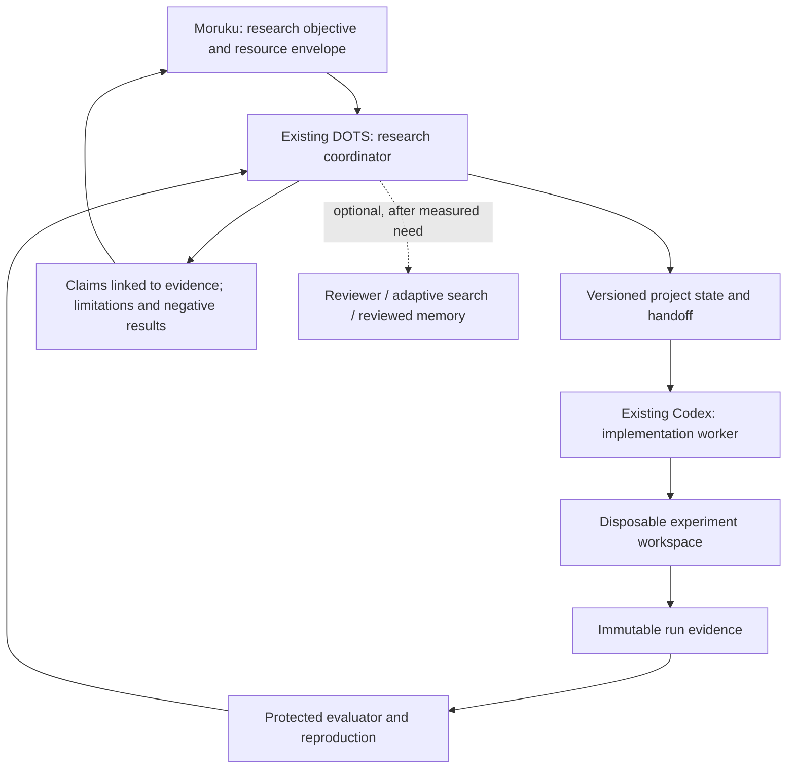

# AI Agent Scientist

[日本語](README.ja.md) | English

**A DOTS-centered research harness for turning a question into a testable hypothesis, a reproducible experiment, and an evidence-backed conclusion using existing ChatGPT and Codex.**

DOTS coordinates the research. Codex implements and runs bounded experiments. External project records preserve the facts, and an evaluation boundary checks the evidence. The goal is useful research progress, not simply generating papers or maximizing an AI review score.

**Status: detailed design, 2026-11-09 JST.** No research runtime, DOTS connection, experiment execution, paid API/GPU use, or performance improvement is delivered by this repository. Examples are inactive design fixtures.

## The proposed fit for Moruku's environment

- Keep the existing DOTS and ChatGPT/Codex workflow; no replacement agent runtime or new model subscription is required by the design.
- Start with one research project, one implementation worker, and a CPU-only experiment profile.
- Use a dedicated disposable workspace on an accepted connected computer. The NUC's existing automation/monitoring services and isolated security VM are not research sandboxes.
- Retain project state outside conversation memory. A new task receives a concise, versioned handoff.
- Treat existing agent communication and sleep/memory projects as optional integration points with their own acceptance boundaries.

[Environment and assumptions](docs/01-environment.md) distinguishes documented observations, proposed placement, and unknowns.

## System overview

The harness is the project/state/experiment/evaluation layer around existing agents. MCP is one optional interface to that layer, not the whole harness.

## Six studies, one staged design

| Study | What informs this project |
|---|---|
| The AI Scientist | Connect ideas, implementation, experiments and writing, while checking each transition. |
| Minimal harness for autonomous ML engineering | A capable single worker with good tools is the baseline. Complexity must earn its cost. |
| Open-ended AI research shadow evaluations | Engineering success and research contribution require separate judgments. |
| Evolving Agent Teams | Diagnose stagnation and change roles selectively rather than starting with a large fixed team. |
| Darwin Gödel Machine | Archive candidate designs and provenance; evaluate changes outside candidate control. |
| AB-MCTS | Later compare broad candidate generation and deeper refinement under fixed budgets. |

[Research mapping](docs/02-research-foundations.md) provides primary sources, saved reading notes, and limits. This combination is our design synthesis; it is not a result already established by those papers.

## Read the design

| Document | Purpose |
|---|---|
| [01 Environment](docs/01-environment.md) | Current lab fit, observations, constraints and open items |
| [02 Research foundations](docs/02-research-foundations.md) | Six sources → borrowed mechanism → limitation |
| [03 Architecture](docs/03-architecture.md) | Components, placement, storage and trust boundaries |
| [04 Research workflow](docs/04-research-workflow.md) | State machine, hypothesis selection, budgets and stopping |
| [05 DOTS integration](docs/05-dots-integration.md) | Task handoffs, communication, MCP and recovery |
| [06 Experiment contracts](docs/06-experiment-contracts.md) | Plans, run identity, resources, data and evidence |
| [07 Evaluation](docs/07-evaluation.md) | Protected evaluation, reproducibility and scientific validity |
| [08 Adaptive improvement](docs/08-adaptive-improvement.md) | DGM/AB-MCTS/EAT-inspired optional extensions |
| [09 Safety and publication](docs/09-safety-publication.md) | Authorized autonomy, private evidence and public exports |
| [10 Implementation roadmap](docs/10-roadmap.md) | Work packages, acceptance criteria and the first pilot |

Start a project using the [research brief](templates/research-brief.md), [experiment plan](templates/experiment-plan.md), and [run report](templates/run-report.md). The [inactive CPU pilot](examples/cpu-pilot.json) illustrates the proposed contract. A [DOTS handoff](examples/dots-handoff.md) shows the minimum assignment.

The first implementation should complete one loop: **brief → baseline → candidate → repeatable evaluation → evidence-backed report → clean shutdown**. No schedules or live agent requests are created by this design update.

## Design handoff update — 2026-11-09

Read the [implementation contract and acceptance cases](docs/12-protocol-and-acceptance.md) before implementing. This update specifies state ownership, immutable evidence, retry/recovery behavior and evaluation boundaries; it adds design schemas and synthetic examples only. Runtime implementation belongs to a later AI-led change. No performance result or live integration is claimed.

The three repositories remain independently usable. Optional integration follows the [reference-only handoff contract](https://github.com/moruku36/ai-agent-scientist/blob/main/docs/11-harness-boundaries.md); it does not create shared authority or a new agent runtime.
