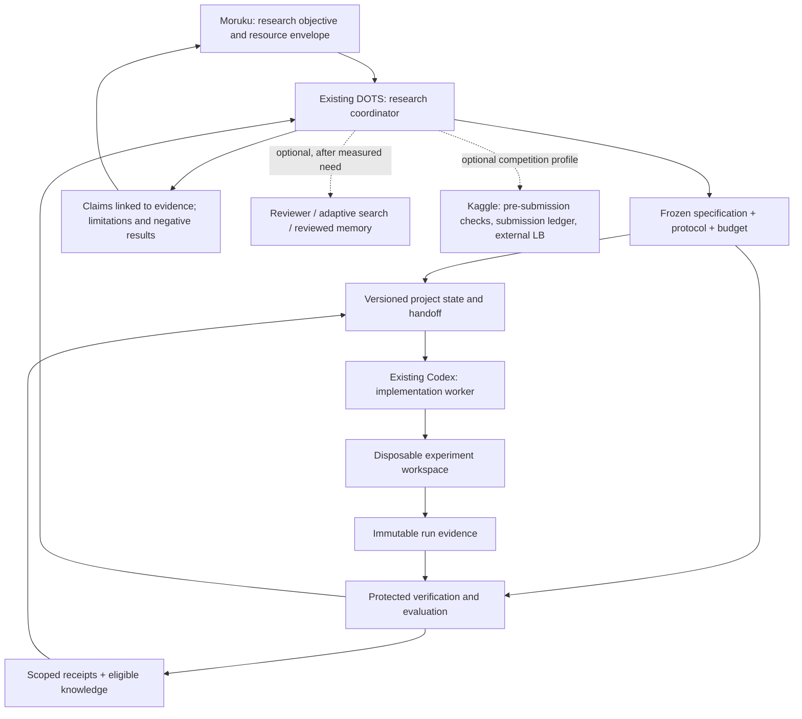

# AI Agent Scientist

> Increment28 coordinator checks: initial six-method run had five successes and one F04 fixture error: immutable-event deletion was correctly refused. A file-only test-fixture correction emulates a legacy missing event outside the trusted API; the sole targeted rerun passed all six F01–F06 methods (0.050s). Existing-environment design checker passed once (620 links, 36 language pairs); whitespace passed. Remaining NOT EXECUTED/pending text records worker authorship, not subsequent checks. Independent review is recorded separately; no runtime acceptance.

**Recovery report increment 28 (2026-11-17): authored, NOT EXECUTED.** The [bounded deterministic private recovery report](docs/28-recovery-report.md) is the third connected offline increment: one actual triage page becomes immutable selected JSON bytes, exact-byte SHA-256 and cursor metadata, with whole-artifact byte-limit refusal. Exactly six NEW self-contained tests and paired docs are authored. All checks for increment 28 remain pending; previous coordinator banners cover earlier increments only. No proof, recovery authority or automatic public export.

> Increment27 coordinator checks: six NEW T01–T06 offline methods passed once (0.045s); existing-environment design checker passed once (594 links, 35 language pairs); whitespace passed. Subsequent NOT EXECUTED/pending statements are worker-only authoring history, not these coordinator results. Independent review recorded separately; no runtime acceptance.

**Recovery triage increment 27 (2026-11-17): source, exactly six NEW self-contained tests and paired docs authored; NOT EXECUTED.** [Conservative receiver-local recovery triage](docs/27-recovery-triage.md) is the second connected offline increment, composing actual reservation inspection snapshots into bounded reason-coded views while retaining every full reservation. It grants no admission, readiness, dispatch or settlement authority. Coordinator checks are pending; earlier validation banners do not cover this increment.

> Coordinator validation (2026-11-17): six new I01–I06 offline contract methods passed once (0.039s); existing-environment design checker passed once (564 links, 34 language pairs); whitespace passed. Independent pinned full-source review found no implementation defect under documented trust assumptions. Later NOT EXECUTED/pending wording records worker-file-only authorship, not the subsequent coordinator checks. No runtime acceptance.

> Coordinator validation, 2026-11-17 (round3 only): six NEW U01–U06 scenarios passed once (1.183s); existing-venv design checker passed once (534 links, 33 language pairs). Independent review pending. Later authored/NOT EXECUTED wording below is historical worker-file-only status, not current coordinator validation. Round2 original raw check receipts remain unavailable; do not infer their verification from round3.

**Outbox coordinator verification (2026-11-17): O01–O06 passed once offline, 0.046s; required design checker passed once (504 links, 32 language pairs). Original selected worker timed out at 600s; no task_complete/final, completion UNKNOWN, no replay. Authored/not-executed wording below records worker-only activity, not current coordinator check status. No live acceptance.**

[日本語](README.ja.md) | English

**A DOTS-centered research harness for turning a question into a testable hypothesis, a reproducible experiment, and an evidence-backed conclusion using existing ChatGPT and Codex.**

DOTS coordinates the research. Codex implements and runs bounded experiments. External project records preserve the facts. Frozen specifications, protected verification and scoped knowledge reuse connect each candidate to checked evidence. The goal is useful research progress, not simply generating papers or maximizing an AI review score.

**Status: detailed design revised 2026-11-16 JST.** Except for the offline helpers described below (arithmetic preflight, exact-byte blob storage, strict JSON blob reads, request preflight, payload binding, local durable receipts and their worker-seconds reservation extension), no research runtime, DOTS connection, experiment execution, paid API/GPU use, or performance improvement is delivered by this repository. Examples are inactive design fixtures. The sixth helper's receipt-only scenarios passed once (1.172s); the reservation extension is implemented with scenarios passed once offline (0.082s); coordinator diff review completed.

## First offline implementation — 2026-11-17

The [pure worker-budget preflight](docs/17-budget-preflight.md) implements only the arithmetic portion of P1 / SCI-05. Ten canonical cases passed once offline. It is not admission, a runner, authorization or live research runtime; the remaining design and disabled examples are unchanged.

## Second offline helper — 2026-11-17

The [immutable exact-byte blob helper](docs/18-immutable-blob-helper.md) stores and verifies opaque bytes by SHA-256 in a trusted local directory (P1 hash/persistence prerequisite). Its twelve E01–E12 cases passed once offline on Python 3.15.2. It is not a registry, canonicalization (JCS), authorization or receipt issuer.

## Third offline helper — 2026-11-17

The [strict JSON blob reader](docs/19-json-blob-reader.md) connects verified bounded blob reads to UTF-8 JSON decoding with duplicate-key and non-finite rejection. Eight J01–J08 cases passed once offline on Python 3.15.2. It is not schema validation, admission, JCS or a registry.

## Fourth offline helper — 2026-11-17

The [handoff request preflight](docs/20-handoff-request-preflight.md) checks a fixed request-only structure and caller-clock expiry after verified strict JSON reads. Eight H01–H08 cases passed once offline on Python 3.15.2. It does not authenticate, authorize, reserve or dispatch.

## Fifth offline helper — 2026-11-17

The [handoff payload binding](docs/21-handoff-payload-binding.md) composes request preflight, current trusted local metadata/access and a bounded verified payload read. Implemented; ten new P01–P10 scenarios passed once offline (0.074s); coordinator source review completed. It grants no admission or dispatch authority.

## Sixth offline helper — 2026-11-17

The [durable byte-bound handoff receipt](docs/22-durable-handoff-receipt.md) connects fresh request/payload verification to receiver-owned local SQLite persistence and one unresolved CAS transition. Implemented; ten new D01–D10 scenarios passed once offline (1.172s); coordinator source review completed. This partial docs11 profile uses exact envelope bytes; full logical/JCS identity remains missing. Its original `record` API grants no admission, reservation or dispatch authority.

## Local reservation prerequisite — 2026-11-17

The [local worker-seconds reservation prerequisite](docs/23-local-budget-reservation.md) extends the receipt transaction with current caller-owned authority and one fixed shared envelope. Implemented; ten R01–R10 scenarios passed once offline (0.082s); coordinator diff review completed. It provides no dispatch or full admission acceptance.

The [transactional receiver-local status outbox](docs/24-local-status-outbox.md) adds atomic retained-reservation/reconciliation events and scoped local acknowledgement CAS. Implementation and exactly six new offline scenarios authored, **not executed**. No sender, transport, remote delivery or settlement is implemented.

The [immutable receiver-local usage observations](docs/25-local-usage-observations.md) (Scientist round3, based on independently source-reviewed round2 `bf4743970dc48e0e89e2717a2e07c2591c8db129`) connect trusted observations to the existing reservation, reconciliation transition and outbox in one SQLite transaction. Implementation and exactly six new methods authored, **NOT EXECUTED**; coordinator checks pending. All reservations remain fully outstanding, the settled floor is unchanged, and UNKNOWN usage/cleanup never releases budget. This is observation retention only, without settlement, metering or authentication claims.

The [receiver-scoped reservation inspection snapshots](docs/26-reservation-inspection.md) connect retained receipts, reservations, current local outbox state, latest inserted usage observations and fixed allocation accounting in one read transaction. Implementation and exactly six new self-contained test methods authored, **NOT EXECUTED**; all checks for this increment remain pending. Only this reservation's allocation/full outstanding amount is exposed, without shared totals or owner identity. This is the first of three bounded offline increments and grants no continuing authority or settlement.

## Kaggle competition support — 2026-11-16

[Competition profiles and the submission boundary](docs/15-kaggle-competitions.md) connect Kaggle to the existing design as "a research task whose evaluator and final holdout belong to the host". Three competitions are covered: Gemma 4 Developer Agent, Name That LLM and Physical-Engineering's Last Exam. Local evaluation is the basis for selection; the public leaderboard is quota-limited external feedback; submitting, accepting rules and publishing are external acts that need the owner's authorization. [Knowledge and OSS candidates](docs/16-kaggle-knowledge-oss.md) are a list, not installed or tested. No competition was joined and no data download, training or submission took place.

## Sakana lifecycle integration — 2026-11-14

The [section-grounded design](docs/14-sakana-lifecycle.md) integrates AI Scientist v1/v2 and The Agentic Scientist: read-only ideation, typed sequential search, separate correctness/rubric/selection gates, frozen confirmation and raw-evidence-grounded reporting. It preserves DOTS, existing schemas and verified knowledge. Complete papers/appendices were not fully read; no runtime or improvement is claimed.

## The proposed fit for Moruku's environment

- Keep the existing DOTS and ChatGPT/Codex workflow; no replacement agent runtime or new model subscription is required by the design.
- Start with one research project, one implementation worker, and a CPU-only experiment profile.
- Use a dedicated disposable workspace on an accepted connected computer. The NUC's existing automation/monitoring services and isolated security VM are not research sandboxes.
- Retain project state outside conversation memory. A new task receives a concise, versioned handoff.
- Treat existing agent communication and sleep/memory projects as optional integration points with their own acceptance boundaries.

[Environment and assumptions](docs/01-environment.md) distinguishes documented observations, proposed placement, and unknowns.

## System overview

The harness is the project/state/experiment/evaluation layer around existing agents. MCP is one optional interface to that layer, not the whole harness.

## Seven studies, one staged design

| Study | What informs this project |
|---|---|
| The AI Scientist | Connect ideas, implementation, experiments and writing, while checking each transition. |
| Minimal harness for autonomous ML engineering | A capable single worker with good tools is the baseline. Complexity must earn its cost. |
| Open-ended AI research shadow evaluations | Engineering success and research contribution require separate judgments. |
| Evolving Agent Teams | Diagnose stagnation and change roles selectively rather than starting with a large fixed team. |
| Darwin Gödel Machine | Archive candidate designs and provenance; evaluate changes outside candidate control. |
| AB-MCTS | Later compare broad candidate generation and deeper refinement under fixed budgets. |
| Discovering formally verified quantum programs with AI | [Specification, verification and knowledge reuse](docs/13-verified-discovery.md), adapted without requiring formal proof for empirical studies. |

[Research mapping](docs/02-research-foundations.md) provides primary sources, saved reading notes, and limits. This combination is our design synthesis; it is not a result already established by those papers.

## Read the design

| Document | Purpose |
|---|---|
| [01 Environment](docs/01-environment.md) | Current lab fit, observations, constraints and open items |
| [02 Research foundations](docs/02-research-foundations.md) | Seven sources → borrowed mechanism → limitation |
| [03 Architecture](docs/03-architecture.md) | Components, placement, storage and trust boundaries |
| [04 Research workflow](docs/04-research-workflow.md) | State machine, hypothesis selection, budgets and stopping |
| [05 DOTS integration](docs/05-dots-integration.md) | Task handoffs, communication, MCP and recovery |
| [06 Experiment contracts](docs/06-experiment-contracts.md) | Plans, run identity, resources, data and evidence |
| [07 Evaluation](docs/07-evaluation.md) | Protected evaluation, reproducibility and scientific validity |
| [08 Adaptive improvement](docs/08-adaptive-improvement.md) | DGM/AB-MCTS/EAT-inspired optional extensions |
| [09 Safety and publication](docs/09-safety-publication.md) | Authorized autonomy, private evidence and public exports |
| [10 Implementation roadmap](docs/10-roadmap.md) | Work packages, acceptance criteria and the first pilot |
| [11 Harness boundaries](docs/11-harness-boundaries.md) | State ownership and optional reference-only exchange |
| [12 Protocol and acceptance](docs/12-protocol-and-acceptance.md) | Frozen scientific comparison and SCI-01–12 |
| [13 Verified discovery](docs/13-verified-discovery.md) | Specification closure, verifier adapters, knowledge promotion and SCI-13–20 |
| [14 Sakana lifecycle](docs/14-sakana-lifecycle.md) | Ideation, sequential search, separate gates and evidence-grounded reporting |
| [15 Kaggle competitions](docs/15-kaggle-competitions.md) | Profiles for three competitions, the submission boundary and KGL-01–10 |
| [16 Kaggle knowledge and OSS](docs/16-kaggle-knowledge-oss.md) | Evaluation-design knowledge, per-competition methods and OSS candidates |
| [17 Budget preflight](docs/17-budget-preflight.md) | Implemented pure arithmetic helper; ten cases passed once offline, not admission |
| [18 Immutable blob helper](docs/18-immutable-blob-helper.md) | Implemented exact-byte local blob helper; twelve cases passed once offline, not a registry |
| [20 Handoff request preflight](docs/20-handoff-request-preflight.md) | Request-only structure and expiry; eight cases passed once offline, not admission |
| [19 Strict JSON blob reader](docs/19-json-blob-reader.md) | Verified blob reads followed by strict decoding; eight cases passed once offline, not record acceptance |
| [21 Handoff payload binding](docs/21-handoff-payload-binding.md) | Current trusted local binding before verified payload read; ten scenarios passed once offline |
| [22 Durable handoff receipt](docs/22-durable-handoff-receipt.md) | Local SQLite exact-byte receipts and unresolved CAS; ten scenarios passed once offline |
| [23 Local budget reservation](docs/23-local-budget-reservation.md) | Connected fixed-envelope worker-seconds reservations; implemented, ten scenarios passed once offline |
| [24 Local status outbox](docs/24-local-status-outbox.md) | Atomic reservation status events and scoped local ack CAS; implementation and six scenarios authored, not executed |
| [25 Local usage observations](docs/25-local-usage-observations.md) | Immutable trusted observations with existing reconciliation/outbox; six methods authored, NOT EXECUTED; no settlement |
| [26 Reservation inspection](docs/26-reservation-inspection.md) | Scoped consistent recovery snapshots and full outstanding allocation; six new methods authored, NOT EXECUTED |
| [27 Recovery triage](docs/27-recovery-triage.md) | Conservative pure classification and connected receiver inspection; six NEW self-contained methods authored, NOT EXECUTED |
| [28 Private recovery report](docs/28-recovery-report.md) | One real triage page to bounded immutable bytes/hash/cursors; six NEW tests authored, NOT EXECUTED |

Start a project using the [research brief](templates/research-brief.md), [experiment plan](templates/experiment-plan.md), and [run report](templates/run-report.md). For a Kaggle competition, add the [competition brief](templates/competition-brief.md). The [inactive CPU pilot](examples/cpu-pilot.json) illustrates the proposed contract. A [DOTS handoff](examples/dots-handoff.md) shows the minimum assignment.

The first implementation should complete one loop: **brief → baseline → candidate → repeatable evaluation → evidence-backed report → clean shutdown**. No schedules or live agent requests are created by this design update.

## Design handoff update — 2026-11-09

Read the [implementation contract and acceptance cases](docs/12-protocol-and-acceptance.md) before implementing. This update specifies state ownership, immutable evidence, retry/recovery behavior and evaluation boundaries; it adds design schemas and synthetic examples only. Runtime implementation belongs to a later AI-led change. No performance result or live integration is claimed.

The three repositories remain independently usable. Optional integration follows the [reference-only handoff contract](https://github.com/moruku36/ai-agent-scientist/blob/main/docs/11-harness-boundaries.md); it does not create shared authority or a new agent runtime.

## Verification-centered revision — 2026-11-11

The [new design](docs/13-verified-discovery.md) extends the existing evaluation boundary rather than replacing DOTS or creating a fixed agent team. Candidates cannot rewrite specification dependencies or promote their own claims. Empirical checks, formal proof, reproduction and scientific contribution remain separate. Checked components and reviewed ideas have different reuse rules; final answers stay outside tuning knowledge.

The revision includes additive verification contracts and disabled synthetic fixtures. Existing protocol and handoff versions are unchanged. Run [offline design checks](scripts/README.md); passing them is not runtime acceptance. Implementation still begins with the bounded CPU slice, with an optional formal verifier only for suitable later tasks.

[29 Local recovery console](docs/29-recovery-console.md)

[30 Local recovery queue](docs/30-recovery-queue.md)
