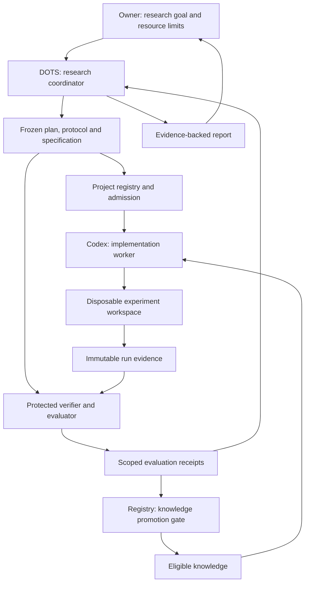

# AI Agent Scientist

[日本語](README.ja.md) | English

A **DOTS-centered research harness design** that uses existing ChatGPT and Codex to turn research questions into testable hypotheses, reproducible experiments, and evidence-backed conclusions.

**Status:** Design documents and offline Python helpers are available. The end-to-end research runtime and live integrations have not passed acceptance testing.

## How it fits together

This diagram shows the **target design**, not deployed services. DOTS coordinates research; Codex implements a bounded plan. Candidate workers do not control the evaluator, authorization, budget, or decisions about what knowledge can be reused.

MCP is optional. Experiment completion, evidence validity, and scientific contribution are evaluated separately. Private data and final evaluation answers stay out of public exports.

## Where to start

| If you want to… | Go here |
|---|---|
| Understand the system | [Architecture](docs/03-architecture.md), [research workflow](docs/04-research-workflow.md), [roadmap](docs/10-roadmap.md) |
| Plan and document an experiment | [Research brief](templates/research-brief.md), [experiment plan](templates/experiment-plan.md), [run report](templates/run-report.md) |
| Check what counts as a valid result | [Protocol and acceptance](docs/12-protocol-and-acceptance.md), [protected evaluation](docs/07-evaluation.md), [verified discovery](docs/13-verified-discovery.md) |
| Inspect the offline implementation | [Source](src/ai_agent_scientist/), [contract tests](tests/contracts/), [schemas](schemas/README.md), [synthetic examples](examples/) |
| Explore a Kaggle project | [Competition design and submission boundaries](docs/15-kaggle-competitions.md) |

## What's implemented offline

The helpers cover budget preflight, immutable byte storage, handoff checks and receipts, reservations and usage records, recovery views, and evidence intake. They do **not** provide full admission, dispatch, settlement, authentication, or execution isolation.

[Existing-run import](docs/38-existing-run-import.md) has synthetic verification recorded. [Explicit-path intake](docs/39-intake-summary.md) is implemented, with checks pending in its design record. Neither establishes real-model or Windows/WSL acceptance; native Windows does not support the required filesystem primitives for these operations.

Run `python scripts/check_design.py` with Draft 2020-12 support in `jsonschema`. See [what the checks cover](scripts/README.md). Passing verifies documentation and schema consistency, not live runtime behavior.

[All documentation](docs/) · [Previous README and verification history](https://github.com/moruku36/ai-agent-scientist/blob/757ef66298720dadc93fd9c39fcf1664503523f7/README.md)
