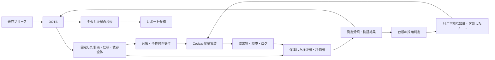

# 03 全体構成

[English](03-architecture.md) | [ホーム](../README.ja.md)

## 責務

| 層 | 担当 | 担当させないこと |
|---|---|---|
| Moruku | 研究目的、資源・データ枠、意義の判断、方向修正 | 許可済みの機械的作業を毎回手実行 |
| 既存DOTS | 研究課題を維持し、情報価値のある次実験を選び、限定依頼と結果統合 | 無記録の無制限計算、架空証拠、暗黙の権限拡張 |
| 研究台帳 | 正本の研究・計画・仕様版、ジョブ状態、予算、候補系譜、知識の利用資格 | タスク完了や自己申告だけで科学的結論を出す |
| Codex実装役 | 許可入力の確認、コード作成、受入計画の実行、失敗報告 | 評価器・評価用データ・許可の変更 |
| 実験ランナー | 作業領域・資源・通信の上限、環境・終了状態の記録 | AI自己採点による研究判断 |
| 保護した検証器／評価器 | 固定仕様・依存との一致、範囲付き受領、固定指標計算、反復確認 | 候補による検証規約変更、最終評価の答えの調整利用 |
| 非公開知識索引 | 利用可能な確認済み結果・部品と、別区分のレビュー済みノートを再利用 | 議論からの直接採用、非公開の答えの送信、権限追加 |
| 報告・書き出し | 主張と証拠の対応、公開候補の作成 | 私的会話や生データの自動公開 |

DOTSは利用者が選んだ既存の統括役です。このリポジトリで作り直しません。役割は同じクライアントで順に担えますが、評価境界は「批判的に読む」という指示だけでなくアクセス制御で成立させます。

## 流れ



計画提出、ジョブ受付、実行成功、有効な結果、新規性のある研究は別々の状態です。

## 保存構成案

初期は、版を確認したPython 3.12互換コード、単一ホストSQLite、追記JSONL、SHA-256で識別するファイル、人向けMarkdownを候補とします。インストール済みではありません。新しいエージェント基盤、ベクトルDB、分散キューを前提にしません。

非公開プロジェクトの構成案：

```text
project/
  brief.md
  sources/index.json
  protocols/<protocol-revision>.json
  verification/contracts/<contract-id>.json
  verification/reports/<report-id>.json
  state/project.json
  candidates/<candidate-id>/manifest.json
  runs/<run-id>/manifest.json
  runs/<run-id>/events.jsonl
  evidence/<sha256>
  claims/ledger.json
  knowledge/index.json
  notes/<note-id>.md
  reports/draft.md
```

評価コード・封印した最終評価データ・許可記録は、**実装ワーカーのマウント／アクセス権限の外**へ置きます。同じ無制限ユーザーが読める別ディレクトリだけでは保護になりません。隔離できないホストでは人が評価を実行し、強い隔離が受入できるまで手続上の境界と明記します。

## 整合性と同時実行

状態遷移の正本は台帳のみ。更新に期待版を付け、古い書込は再読込させます。開始前に実行権の期限と予算を予約し、調査・イベントID、連番、成果ハッシュを記録。終了時は不変マニフェストを残します。

最初は台帳書込1主体・実装役1つ。Gitは版管理でありプロセス間ロックではありません。期限切れジョブは実プロセスと照合してから再試行。証拠の同一内容統合は可能ですが、意図した反復実験を重複として消しません。

PC停止でも研究状態を残し、新しいDOTS作業へ引継ぎ可能にします。復旧で実行中の高価な実験を二重起動しません。

## 接続方式

初期は既存ツールで読み書きするファイル契約から始めます。将来のMCPでは、研究状態取得、計画提出、実験状態、証拠ページ、取消を公開できます。これは機能案であり、DOTSに既にあるツール名ではありません。接続方式に関係なく検証器・ランナーが契約を強制します。

NUC台帳＋遠隔ワーカー化には、認証、暗号化、研究ごとの権限、資源上限、復元が必要。ローカル一周後に追加し、既存閲覧専用MCPとは分離します。今回の接続実装はありません。

## 実装契約の具体化

[11 責務と受け渡し](11-harness-boundaries.ja.md)が正本の分担、重複配送、fencing、親子予算、固定schemaを定め、[12 評価と受入](12-protocol-and-acceptance.ja.md)が固定計画・評価受領・SCI-01〜12を定める。旧CPU例の1,800秒では72試行×最大600秒を予約できないため、実manifestと総予算を起動前に整合させる。今回の更新は設計と合成例の検査までで、実行時受入は未実施。

## 仕様と知識の境界

[13](13-verified-discovery.ja.md)が追加の検証契約・受領を定めます。上記パスは台帳記録や保護検証器の受領であり、候補の書込権限ではありません。正本仕様・検証器・固定依存・最終データはワーカー権限の外に維持。知識は台帳の選別viewとし、互換性のある開発証拠だけを調整へ渡します。別サービスや固定チーム構成は不要です。
