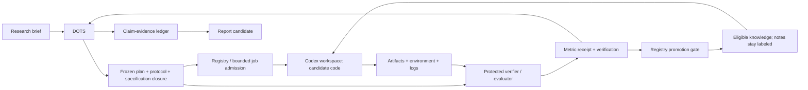

# 03 Whole-System Architecture

[日本語](03-architecture.ja.md) | [Home](../README.md)

## Responsibilities

| Layer | Responsibility | Must not own |
|---|---|---|
| Moruku | Research objective, acceptable resources/data, interpretation of significance, steering | Routine mechanical execution of every authorized step |
| Existing DOTS | Maintain agenda, select next informative experiment, assign bounded work, integrate results | Unrecorded unlimited compute, fabricated evidence or implicit permission expansion |
| Project registry | Canonical project/protocol/specification revisions, job state, budgets, candidate lineage and knowledge eligibility | Scientific conclusions inferred from task completion or worker self-certification |
| Codex implementation worker | Inspect permitted inputs, write code, execute accepted plan and report failures | Evaluator/holdout/permission mutation |
| Experiment runner | Enforce workspace/resource/network limits, record environment and process outcomes | Research judgment or model self-score as ground truth |
| Protected verifier/evaluator | Check pinned specification/dependency bindings, issue scoped receipts, calculate frozen metrics and repeat experiments | Candidate-controlled verifier policy or tuning on final answers |
| Private knowledge index | Reuse eligible checked results/components and separately labeled reviewed notes | Direct promotion from discussion, hidden-answer export or new authority |
| Reporting/export | Map claims to evidence and prepare a selected public report | Automatic export of private transcripts or raw datasets |

DOTS is the coordinator already selected by the user, not a service this repository implements. Logical roles may run sequentially through the same client. Separation of evaluation is enforced by access control, not just by telling the same AI to “be a reviewer.”

## Data and control flow



A submitted plan is not an accepted job; an accepted job is not a successful process; a successful process is not a valid result; a valid result is not novel science.

## Lifecycle artifacts and decision ownership

The [Sakana integration](14-sakana-lifecycle.md) maps TaskSpec onto existing frozen manifests and introduces conceptual IdeaContract, SearchNode, DecisionReceipt and claim/figure records for later implementation. They are private registry objects, not fields added to closed wire schemas. Proposal workers cannot execute; implementation workers cannot issue correctness receipts. Registry decisions record rubric completion separately from incumbent selection and knowledge promotion. Reporting resolves numbers to raw artifacts; a read-only audit cannot mutate the protocol or manufacture receipts.

## Storage proposal

For the first local implementation: Python 3.12-compatible code after version acceptance, SQLite for a single-host registry, append-only JSONL event records, filesystem blobs identified by SHA-256, Markdown for human review. These are proposed choices, not installed dependencies. No extra agent framework, vector DB or distributed queue is required initially.

Suggested private project layout:

```text
project/
  brief.md
  sources/index.json
  protocols/<protocol-revision>.json
  verification/contracts/<contract-id>.json
  verification/reports/<report-id>.json
  state/project.json
  candidates/<candidate-id>/manifest.json
  runs/<run-id>/manifest.json
  runs/<run-id>/events.jsonl
  evidence/<sha256>
  claims/ledger.json
  knowledge/index.json
  notes/<note-id>.md
  reports/draft.md
```

Evaluator code, sealed holdout and authorization records live **outside the implementation worker's mount/access domain**. Keeping them in a second directory under the same unrestricted user is not sufficient protection. On a host without that isolation, use an owner-operated evaluation step and label the boundary procedural until stronger execution isolation is accepted.

## Integrity and concurrency

The registry is the sole authority for state transitions. Each update carries the expected revision; a stale writer reloads rather than overwrites. Reserve a job lease and budget before launch. Record run/event IDs, sequence numbers and artifact hashes. Export an immutable manifest before closing the run.

Start with a single registry writer and one active worker. Git records protocol/source revisions; it is not a cross-process lock. A queued job with an expired lease is reconciled with actual process state before any retry. Immutable artifacts may be deduplicated; scientific trials must not be silently deduplicated when an intentional replicate is requested.

Local worker outage leaves project state intact. A DOTS task can be replaced using a fresh handoff. Recovery must not automatically duplicate a running expensive experiment.

## Interface choices

The minimum interface is file-based task/result manifests with existing client tools. A later MCP adapter may offer conceptual capabilities such as project snapshot, plan submission, run status, evidence paging and cancellation. These names are design concepts, not claims about tools installed in DOTS. A validator and runner enforce contracts regardless of the transport.

A NUC-hosted registry and remote workers require accepted identity, encrypted transport, per-project authorization, quota enforcement and backup/restore. Introduce that only after the local loop works. The existing report MCP stays read-only and separate. No live wiring is created here.

## Concrete implementation contracts

[11 Ownership and handoffs](11-harness-boundaries.md) defines state authority, duplicate delivery, fencing, parent/child budgets and pinned schemas. [12 Evaluation and acceptance](12-protocol-and-acceptance.md) defines the frozen protocol, receipt binding and SCI-01–12. The old 1,800-second CPU sketch cannot reserve 72 attempts at up to 600 seconds each; reconcile the actual run manifest and total budget before launch. This update checks design/examples only, not runtime acceptance.

## Specification and knowledge boundary

[13](13-verified-discovery.md) defines the additive verification contract and report. The private paths above hold registry records or protected-verifier receipts; they do not grant a candidate write access. The actual protected specification, verifier, dependency locks and final data remain outside the worker domain. Knowledge is a filtered registry view, not an unrestricted feedback loop: only compatible development evidence can seed tuning. No extra service or fixed agent hierarchy is required.
