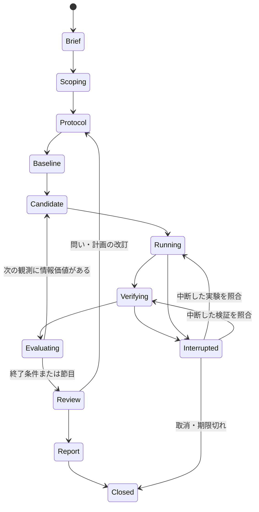

# 04 研究の進め方

[English](04-research-workflow.md) | [ホーム](../README.ja.md)

## 研究の状態

研究全体と個別ジョブを分けます。ジョブは `queued→leased→running→completed／failed／cancelled／expired`。completedは証拠回収で、仮説の成功ではありません。保留時は具体的依存を記録し、独立に終えた作業を維持します。中断した工程とジョブ／試行IDを保持し、その期限・実プロセス・受領を照合して同じ工程へ戻ります。検証結果の喪失で実験を再起動しません。

## 1. 問いを狭める

DOTSがブリーフと出典を読み、最初は仮説を最大3案に絞ります。反証可能な予測、比較対象、測定、交絡、最安の判別実験、費用見込み、終了条件を持たせます。「賢いAIを作る」より「同じ文脈予算で証拠ページ化が根拠のない断定を減らすか」のように定義。

文献検索語、出典・版、根拠箇所、不確実性を記録します。AIが案を思いついたことだけで新規性ありとしません。使えないデータや高価な機材が必要なら、実装前に問いを狭めます。

## 2. 計画を固定する

探索・開発用検証・最終評価を分離。主要指標、基準版、集計単位、乱数・反復、資源枠、候補選定、除外、反証条件を固定します。無効な結果と、期待に反する有効結果を区別します。

結果を見た後の仮説・指標・除外・終了規則の変更は別の計画版。旧版を残し、新分析は探索的と明示。後から黙って成功条件を変えません。

freezeには[検証契約](13-verified-discovery.ja.md)も結び、正本仕様の依存全体、候補の差替え範囲、検証器／環境、主張の確認条件、目的コスト規約を固定します。既存計画に追加するmanifestであり、別の編集可能な定義ではありません。改善の解釈前に、同じ契約で基準も記録します。

## 3. 基準を成立させる

最も単純な基準を実装・実行し、出力、測定の負荷、資源を確認。改善を測る前に、合成試料で期待結果との一致を確かめます。壊れた基準は履歴を残して修正してから比較します。

## 4. 候補を一つ測る

コード・設定の不変な版を計画で指定。ランナーが枠を検証・資源予約して起動します。エラー、中間保存、試した全設定を記録。時間超過も資源消費と失敗として残し、履歴から除きません。

作業上の短い判断・観測・次作業を残し、非公開の内部思考は要求しません。方法変更は候補系譜へ紐付けます。

結果解釈の前に保護検証器が不変候補を固定契約と照合し、範囲付き受領を発行します。不合格・保証非対応・timeoutを明示し、局所試験やAIレビューで受領を代用しません。その後は既存4軸の研究評価。検査済み開発結果・部品を再利用候補にし、レビュー済み案は提案のまま保持。最終feedbackを次候補へ使う場合は接触記録と評価集合の確認的利用終了が必要です。

## 5. 次の実験を選ぶ

何が不明か、どの観測なら判断が変わるか、残予算に見合うかをDOTSが検討。支持・反証・判断不能のどれも有効です。指標の微改善だけが続き研究の問いに答えられないなら、方向を見直します。

初期の停滞条件案は「有効候補3件で、事前定義した意味のある開発改善なし」。役割や枝を増やす前に測定・仮説・方法を点検。試行用の調整値であり、論文が保証する最適値ではありません。

## 6. 止めて報告する

予算・期限、スコープ不備、信頼できる評価の欠損、基盤の反復失敗、利用者取消、研究上の終了条件で止めます。予算を自動追加しません。支持できる最も強い主張、反証、否定的結果、不確実性、再現資料を揃えて終了。

研究意義は節目に人が確認します。許可枠内の通常作業は包括確認を繰り返さず継続。公開・外部連絡は実際の許可範囲に応じた別操作とします。

## 目的付き探索と固定候補の確認

上の状態機械の中で[14](14-sakana-lifecycle.ja.md)を適用。読取専用着想が反証条件・親・rubricを定義し、受付後に実装します。逐次ノードは目的と全試行消費を記録。正しさ確認、rubric完了、開発用選択規則を別判定にします。候補固定後にbaseline／ablation／replicationを統制確認し、事後診断は探索的と明示して黙って再選択しません。集計は実験を起動せず、主張／図対応と読取専用監査を経て許可された書出しへ。予算終了・否定的結果・不明を報告し、実行不明は元試行を照合してから再試行します。

## 最初の研究課題案

所有する合成の複数段階課題で、**生ログだけの引継ぎ**と**証拠索引付きの上限付き引継ぎ**を比較。モデル・クライアント、入力、呼出・時間予算を揃え、要件喪失、重複作業、根拠のない主張、完了、引継ぎ量を測ります。まずモデル呼出なしで台帳を検証し、次に小さなモデル実験の枠を設定。GPU学習なしでハーネスの一部を研究できます。
