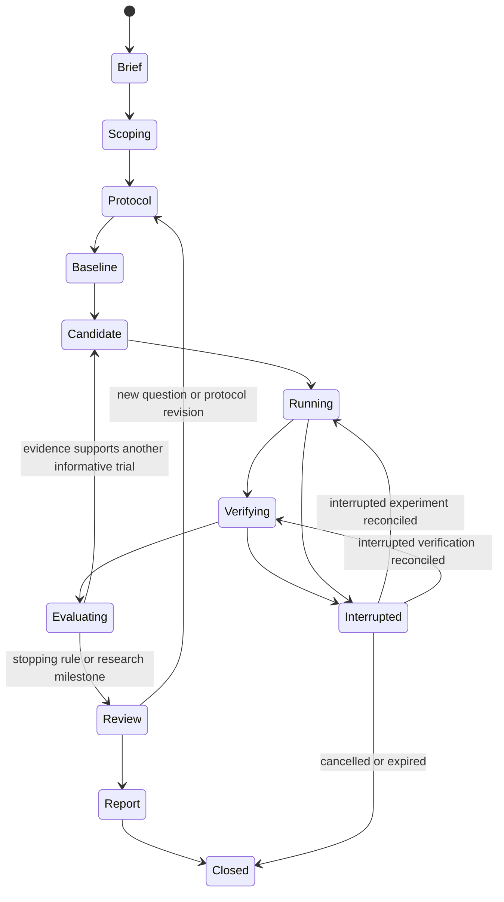

# 04 Research Workflow

[日本語](04-research-workflow.ja.md) | [Home](../README.md)

## Research state machine

The project lifecycle is distinct from a job lifecycle: `queued → leased → running → completed | failed | cancelled | expired`. Completed means execution artifacts were captured, not that the hypothesis succeeded. Blocked/waiting states record the concrete dependency and preserve completed independent work. An interruption retains the exact stage and job/attempt identity. Reconcile its lease, process and receipt before returning to that stage; a lost verification result must not relaunch the experiment.

## 1. Scope a question

DOTS reads the brief and source list, then proposes at most three initial hypotheses. Each names a falsifiable prediction, relevant baseline, measurable outcome, plausible confounder, cheapest discriminating experiment, expected cost and stopping rule. “Build a smarter agent” is too broad; “does evidence paging reduce unsupported conclusions under the same context budget?” is testable.

Track literature search query, source/version, supporting passage reference, and uncertainty. A model suggesting a plausible idea does not establish novelty. If the question needs unavailable data or expensive hardware, narrow it before implementation.

## 2. Freeze the protocol

Separate exploration data, development validation and final evaluation. Freeze the primary metric, baseline revision, unit of analysis, seeds/repetitions, resource envelope, candidate-selection rule, exclusions, and what would refute the claim. Define when a result is invalid versus merely disappointing.

A new hypothesis, metric, data exclusion or stopping rule after seeing results creates a new protocol revision. Retain the original and label the new analysis exploratory. Do not quietly move the goalposts.

The freeze also binds a [verification contract](13-verified-discovery.md): trusted specification dependencies, allowed candidate replacements, checker/environment, claim obligations and objective cost conventions. This is an additional manifest over the existing plan/protocol, not a second editable definition. Record the baseline under the same contract before interpreting a candidate gain.

## 3. Establish the baseline

The worker builds/runs the simplest accepted baseline and checks outputs, measurement overhead and resource use. Compare known expected outcomes on synthetic fixtures before measuring a proposed improvement. A broken baseline must be repaired transparently before any relative gain is reported.

## 4. Implement and measure one candidate

The plan selects an immutable code/config revision. The runner validates the envelope, reserves resources and starts one job. The worker records errors, intermediate checkpoints and all attempted configurations. A timeout counts as resource consumption and a failed attempt; it is not removed from the history.

During a run, record concise decisions, observations and next steps, not private hidden reasoning. Feedback that changes the method is attached to the candidate lineage.

Before interpreting outcomes, a protected verifier checks the immutable candidate against the frozen contract and emits a scoped receipt. Failure, unsupported assurance and timeout stay explicit; neither a local test nor an AI review substitutes for that receipt. Scientific evaluation then uses the existing four gates. A checked development result or component can be considered for reuse; reviewed ideas remain proposals. Final feedback cannot flow into the next candidate without recording exposure and retiring that set.

## 5. Decide the next experiment

DOTS asks: what uncertainty remains, which observation would change the decision, and is that observation worth the remaining budget? Support, refutation and inconclusive evidence are all valid. Repeatedly making a metric slightly better without answering the research question is a reason to review the direction.

Initial proposed stagnation trigger: three valid candidates without a predeclared meaningful development improvement. Review the measurement, hypothesis and approach before adding roles or branches. This is a tunable pilot rule, not a paper-derived optimum.

## 6. Stop and report

Stop on any hard budget/expiry, invalid scope, missing trusted evaluation, repeated infrastructure failure, owner cancellation, or the predeclared scientific stopping condition. Do not auto-increase budget. Close with the strongest supported claim, counterevidence, negative results, uncertainty and a reproducible artifact list.

The owner reviews scientific relevance at milestones; routine work within the authorized envelope continues without repeated blanket permission. Publication and external correspondence are separate actions, governed by the actual authorization.

## Example first research question

Compare **raw-log-only handoffs** with **bounded evidence-indexed handoffs** on owned synthetic multi-step tasks, holding model/client, inputs and call/time budgets fixed. Measure lost requirements, repeated work, unsupported claims, completion and handoff size. First validate the bookkeeping without any model calls; then authorize a small matched model experiment. This tests one part of the harness without requiring GPU training.
