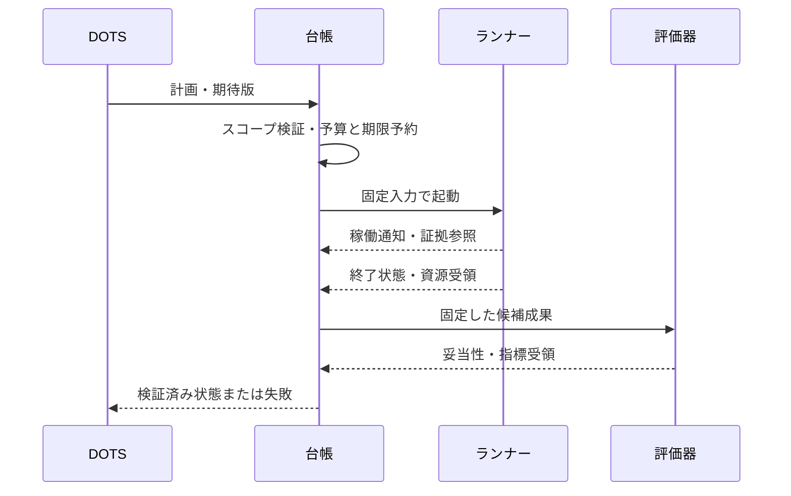

# 06 実験契約と実行

[English](06-experiment-contracts.md) | [ホーム](../README.ja.md)

## 識別と固定入力

研究、仮説、計画版、候補、run、再試行、反復のIDを分けます。request keyは論理依頼を識別し、再送は既存実行の照合に使い、意図した再実験は別replicate ID。実行前に入力・コード・環境ハッシュを残します。ハッシュは内容識別であり、正しさや秘匿性の証明ではありません。

計画には、問い、基準／候補版、データ・分割参照、指標／評価器版、乱数一覧、成果、許可操作、資源・全体予算、終了条件を持たせます。スキーマは構造確認に留まり、意味・権限の検証は別に必要です。

## 初期実行プロファイル

CPU試行の上限案：同時1件、CPU 2コア、メモリ4 GiB、一時領域2 GiB、1回600秒、合計1,800秒、GPUなし、通信なし、有料API支出なし。**実ホストの空き容量を測った値ではなく上限案**です。予約できない場合は小さくします。

設定は初期無効。許可根拠欠損、期限切れ、非対応隔離、依存固定不明、資源不足は拒否。強制できない上限を黙って無効化しません。

使い捨てコンテナ／VMまたは受入済み制限実行環境を用い、ホスト管理ソケット、ホーム全体のマウント、本番認証情報を持ち込みません。研究コードは境界内で実行でき、静的解析だけに限定しません。宣言したentrypointを型付き引数で起動し、ネットワーク越し汎用シェルにはしません。

依存取得は別の準備工程で版・ハッシュ・ライセンスを確認して環境固定。オフライン実験の実行通信は無効。契約確認だけのためにCUDAやモデルを導入しません。

## 状態と復旧

実行前に最悪時の枠を予約し、取得できた実測で精算。不明な失敗は保守的に枠を残します。受付と評価の記録はワーカー書換不可。自己申告で予算を返金できません。

時間超過・取消では子プロセス群を停止し、残存確認、部分結果、終了理由を記録。再起動時は実プロセス・成果から照合し、通知欠損だけで停止済みとしません。OOM・ディスク不足は基盤結果で、ゼロ点や最高点へ変換しません。

## 証拠形式

run／試行、計画・成果ハッシュ、時刻、状態、資源、ツール／環境版、標準出力・エラー参照、指標受領、限界を持たせます。状態はcompleted／partial／failed／timeout／cancelled／rejected。指標の有効性は別フィールドとし、欠測は欠測のまま残します。

原文は非公開保管し、エージェントへページ取得と切捨て表示を提供。派生要約から原文へ参照。差分、lockfile／環境イメージ、乱数、ハードウェア／実行環境、測定方法を保存します。大規模データは管理領域へ置き、Gitには出典・ライセンス・版・ハッシュだけを記録。

[run記録スキーマ](../schemas/run-record.schema.json)は設計契約で、完全な検証実装ではありません。時刻はタイムゾーン付きISO 8601。内部UTC、利用者向け要約は必要に応じJST。終了・評価・公開時刻を区別します。

## データ境界

所有する合成データから開始。公開データもライセンス・評価分割を扱います。必要な秘匿処理をしてからモデル／クラウドへ渡します。データ公開と、調整担当へ最終解答を渡すことは別です。評価時に分割ハッシュと評価器主体を検証します。

例は起動設定ではありません。計画を読む／コミットするだけで実験を起動しません。

## 実装契約の具体化

[11 責務と受け渡し](11-harness-boundaries.ja.md)が正本の分担、重複配送、fencing、親子予算、固定schemaを定め、[12 評価と受入](12-protocol-and-acceptance.ja.md)が固定計画・評価受領・SCI-01〜12を定める。旧CPU例の1,800秒では72試行×最大600秒を予約できないため、実manifestと総予算を起動前に整合させる。今回の更新は設計と合成例の検査までで、実行時受入は未実施。
