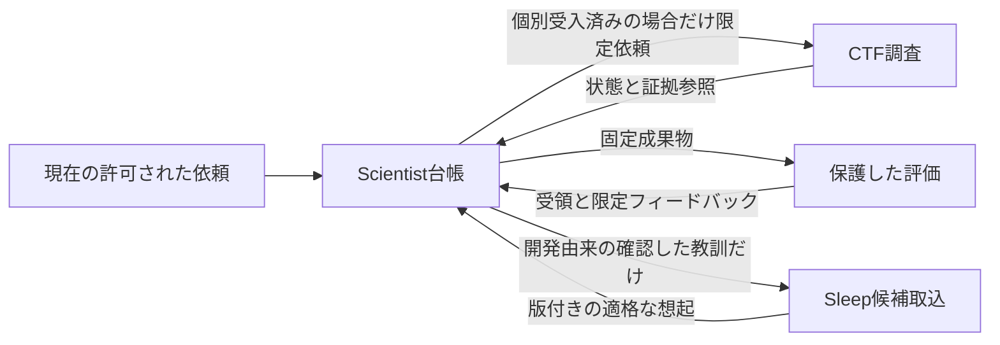

# 11 三つのハーネスの責務と受け渡し契約

[English](11-harness-boundaries.md) | [ホーム](../README.ja.md)

状態：2026-11-09の設計。別の実装担当AIへ渡すための仕様であり、ランタイム・サービス・依頼・定期処理・接続は作成しない。各repoは単独で成立し、相互接続は任意とする。

## 1. 状態ごとに正本を一つにする

| 正本・管理主体 | 担当 | 担当しないもの |
|---|---|---|
| 現在の利用者・クライアントの許可 | 目的、権限、資源上限、公開範囲 | モデルが生成した主張の正しさ |
| Scientist台帳 | 研究計画、候補の系譜、予算予約、run・評価参照 | セキュリティ調査の許可、記憶採用、DOTS内部記憶 |
| [CTF VDP Harness](https://github.com/moruku36/ctf-vdp-harness) | 調査scope、解析action・session、原証拠、ローカル検証 | 研究全体の予算増額、長期記憶の採用 |
| [Agent Sleep Lab](https://github.com/moruku36/agent-sleep-lab) | 適格な経験、確認済み候補、active版、除外台帳 | 現在の作業状態、権限、評価解答、研究の結論 |
| 保護した評価器 | 固定した採点処理、課題・参照解、評価受領 | 候補の編集、報告に都合のよい結果の選択 |

現在の研究状態はScientist台帳が正本。sleepは再利用できる知識であり、第二の進行台帳にしない。許可参照は正本を照合するキーで、アクセス用credentialではない。共有の書込みDB、本番credential、必須の共通Pythonパッケージを導入しない。

## 2. 許される情報の流れ

セキュリティツールの研究を、対象調査への許可に読み替えない。CTFは既存クライアントから直接利用でき、sleepは論文整理だけでも使える。Scientistの汎用研究コード実行を、CTFのMCP capabilityから呼べるようにしない。

adapterは目的・scope・出典・返却許可を照合し、選択した派生教訓だけを書き出す。flag、生通信、私的全文、最終評価の解答はsleepへ渡さない。一般化した文章でも匿名化や解答漏洩除去の証明にはならない。最終評価のフィードバックを以後の改善に使った時点で接触を記録し、その集合を確認的評価から退役させる。

## 3. 参照だけを運ぶ共通envelope

提案する通信契約の正本は[handoff.schema.json](../schemas/handoff.schema.json)、版は`harness-handoff/1`。[合成依頼](../examples/handoff.synthetic.json)は無効の例。任意コード、command、生観測、実行指示をenvelopeへ入れない。

| フィールド | 意味 |
|---|---|
| `message_id` | 配送イベント。同じbytesの再送は同じID |
| `request_id` | 論理依頼。再配送で新規作業を始めない |
| `attempt_id` | 一回の試行。照合を経て再試行を認めた場合だけ変更 |
| `replicate_id` | 科学的な反復。配送再試行から勝手に作らない |
| `project_id`, `sender`, `recipient` | 対象と論理接続先。認証の証明ではない |
| `kind`, `in_reply_to` | request / status / result / cancelと因果関係 |
| `expected_revision` | 変更対象を管理する受信側の期待版。0は新規作成だけ |
| `authorization_ref`, `budget_reservation_ref` | 受信側が正本から照合する制御参照。想起から権限を復元しない |
| `payload` | 不変のローカル認可対象を示す`{id, sha256, media_type, classification}` |
| `created_at`, `expires_at` | UTC時点。実プロセスのleaseとは別 |

受信側は通信を独立に認証し、ローカルの許可された解決器でIDから内容を取得し、hash・型・サイズ・アクセスを検査する。本文中のURIを自動取得しない。未対応版、余分なフィールド、非有限数、重複JSONキー、不正日時は配送前に拒否。JSON Schemaのdate-timeはformat検査を有効にする。構造検査だけでは意味制約を保証しない。

`(認証済み送信者, project_id, request_id)`が同じで内容も同じなら既存jobを返す。内容違いは競合で、更新と扱わない。requestのdigestと最後の受領を配送再試行期間より長く保持する。計画変更は新request。`message_id`は配送、`request_id`は論理作業の重複を防ぐ。

初回`request`の`attempt_id`と`in_reply_to`はnull。受付後に受信側がattemptを割り当てる。内部の実行再試行は受付済みjob内で新attemptを作り、変更したrequestの再送にはしない。論理request digestはproject、接続先、replicate、期待版、許可／予約参照、payload、元の期限から計算し、配送message IDと作成時刻を除く。status／resultは独自message IDでrequestを参照し、新requestのpayloadとして競合比較しない。

## 4. 配送・lease・取消

少なくとも一回の配送を想定し、exactly-once実行は保証しない。依頼と予算予約を永続化してから受付応答する。状態更新と同じローカルトランザクションでoutboxを作り、後から再配送できるようにする。repo間のcommitを分散トランザクションとみなさない。

| 事象 | 必須動作 |
|---|---|
| 受付応答が消失 | 同じ依頼を照会・再送し、既存受領を返す。再起動しない |
| 同じキーでpayload変更 | 競合として拒否し、診断用hashを保持 |
| 状態が順不同で届く | 監査記録に残し、現在版を巻き戻さない |
| message期限切れ | 新規配送を拒否。受付済みjobは自身の許可・leaseで照合 |
| heartbeat消失 | 要照合にし、supervisorと実プロセスを確認してから再試行 |
| lease切れ後の新worker | より大きいfencing tokenを発行し、旧tokenの書込みを拒否 |
| 取消依頼 | 取消要求を記録し、実プロセス群停止、部分証拠・使用量保存、cleanup後に終端応答 |
| 完了と取消が競合 | 台帳で直列化。完了証拠を残し、観測した結果とcleanupを記録。架空の取消結果を作らない |

応答消失はモデルの忘却の証拠ではない。統括の停止もworker停止の証明ではない。実在が不明なら予約を保持して重複起動を止める。再起動後のPIDだけでは足りず、host・supervisor instance・process start identity・fencing tokenを対応付ける。

## 5. 予算の合成

Scientistが親予算を予約してから委譲し、CTF／sleepはそれ以下の子予算を強制する。同じ仕事を両側で記録しても、安定したreservation IDで一度だけ計上する。子serviceが親上限を増額したり、未信頼workerの自己申告だけで返金したりしない。

経過wall時間、課金対象worker時間、model calls／tokens、追加支出、証拠bytesを分ける。並行実行のwall時間とworker時間合計は異なる。各資源で`確定使用量 + 未精算予約 <= 許可上限`を保つ。使用量不明は0にせず、照合まで保守的に予約を保持。再試行・評価・失敗候補・cleanupも対象とし、記憶作成・取得費用は負担元と内訳を分けて追跡する。

## 6. hash・版・アクセス

artifactのSHA-256は保存したbytesそのものから計算する。構造化manifest IDは自身のID／hash／署名を除き、[RFC 8785 JCS](https://www.rfc-editor.org/rfc/rfc8785)で正規化する。重複キー・非有限数は事前拒否。言語独自のキーソートJSONをJCSと呼ばない。canonical bytesとserializer版を保持し、移行試験に使う。

参照は内容とschema版を固定し、可変の`main`／`latest`を使わない。hashは権限・署名・真実性・暗号化ではない。現在のアクセスが失効すれば、監査用の実体が残っていても取得不可にする。受領は入力・計画・評価器・候補の各版へ結び付け、一つでも置換したら再利用できない。

wire版は明示した移行を受入するまで完全一致。移行は新objectと旧新対応を作り、過去証拠や確認結果を捏造・上書きしない。実装repoは受入したschemaをローカルへ固定し、元commit／hashを記録する。実行時にこのrepoやremote `$ref`を取得しない。正本契約の変更前に互換性を確認する。

## 7. 実装順序と受入

1. 各repo単独のオフライン一周を、偽transportと所有fixtureで作る。
2. 二つの構成間で、ファイルを使う参照型request／receiptを受入する。
3. 再配送、古い版、取消競合、アクセス失効、worker消失、hash不一致を試す。
4. その後に実クライアント／MCP接続とidentity対応を受入する。
5. 固定課題と総費用の計画で一つの接続の寄与を測り、三つ同時に複雑化しない。

最初の到達点にlive DOTS API、新provider、REM、木探索、並列agentは不要。将来の実装PRではschema版、状態の管理主体、異常系の実測、資源上限、未受入を報告する。[評価と引継ぎ受入](12-protocol-and-acceptance.ja.md)へ続く。

## 検証・知識の責務追加 — 2026-11-11

[検証改訂](13-verified-discovery.ja.md)は `harness-handoff/1` のwire項目やrepo間権限を変更しません。契約／受領objectは、各側で互換性を受け入れてから内容固定payload参照として渡します。仕様freeze・知識利用資格はScientist台帳、範囲付き受領の発行は保護検証器が担当。sleepはレビュー済み教訓を提案できても検証・採用を成立させません。共有可変wikiや自動エージェント会議は導入しません。
