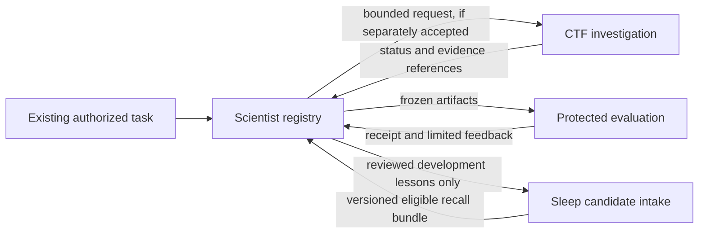

# 11 Three Harnesses: Ownership and Handoff Contract

[日本語](11-harness-boundaries.ja.md) | [Home](../README.md)

Status: design only, 2026-11-09. This specification closes interface decisions for a later implementing AI. It creates no runtime, service, task, schedule or connection. Each repository must remain useful on its own; integration is optional.

## 1. One owner for each kind of state

| Authority | Owns | Does not own |
|---|---|---|
| Existing user/client authorization | Current objective, permissions, resource ceiling, publication scope | Truth of model-generated claims |
| AI Agent Scientist registry | Research protocol, candidate lineage, experiment reservations, run/evaluation references | Security scope, sleep promotion, DOTS internal memory |
| [CTF VDP Harness](https://github.com/moruku36/ctf-vdp-harness) | Investigation scope, analysis actions/sessions, original evidence, local verification | Research-wide budget increases or long-term memory activation |
| [Agent Sleep Lab](https://github.com/moruku36/agent-sleep-lab) | Eligible experience, verified memory candidates, active snapshot, exclusions | Current task state, authorization, evaluator answers or research conclusions |
| Protected evaluator | Frozen metric implementation, task labels/reference answers, evaluation receipts | Candidate editing or selecting an outcome to report |

The project registry is the source of current research state. Sleep memory is reusable knowledge, not a second registry. A permission reference is a lookup key to an authoritative record, not a bearer credential. No shared writable database, shared production credentials or required shared Python package is introduced.

## 2. Allowed data flows

Research on security tools does not authorize a target investigation. CTF remains usable directly from the existing client. Sleep may operate on paper-curation experience without either other repository. CTF integration never exposes the scientist's general experiment runner through a security MCP capability.

An adapter exports selected derived lessons only after checking purpose, scope, provenance and output permission. Raw flags, target traffic, private transcripts and final-evaluation answers stay out of sleep. Generalization is not proof of anonymization or removal of answer leakage. Once final feedback is used for future improvement, record that exposure and retire the set from confirmatory use; do not relabel it as untouched.

## 3. Common reference-only envelope

The canonical proposed wire contract is [handoff.schema.json](../schemas/handoff.schema.json), version `harness-handoff/1`. It carries references, not arbitrary code, commands, raw observations or instructions. The [synthetic request](../examples/handoff.synthetic.json) is inactive.

| Field | Meaning |
|---|---|
| `message_id` | Transport event identity; retransmission of the same bytes retains this ID |
| `request_id` | Logical assignment; duplicates must not start new work |
| `attempt_id` | One execution attempt; changed only after reconciliation authorizes a retry |
| `replicate_id` | Intentional scientific repetition; never created by delivery retry |
| `project_id`, `sender`, `recipient` | Intended domain and logical endpoints; not authentication evidence |
| `kind`, `in_reply_to` | request / status / result / cancel and causal link |
| `expected_revision` | Recipient-owned state revision for a mutation; zero means initial creation only |
| `authorization_ref`, `budget_reservation_ref` | Receiver-resolved control records; never copied from retrieved memory as authority |
| `payload` | `{id, sha256, media_type, classification}` for an immutable, locally authorized object |
| `created_at`, `expires_at` | UTC instants; not a process lease |

The receiver authenticates the transport independently, resolves the IDs using a local allowlist, and checks actual object hash/type/size/access. It must not dereference a URI supplied in source text. Unsupported versions, extra fields, non-finite numbers, duplicate JSON keys and invalid timestamps are rejected before dispatch. JSON Schema validation must enable date-time format checking; shape validation alone cannot prove these semantic conditions.

For the same `(authenticated sender, project_id, request_id)`, identical request content returns the existing job. Different content is a conflict, not an update. Retain the request digest and last receipt beyond the transport retry window. A changed protocol creates a new request. `message_id` handles delivery deduplication; `request_id` handles logical work deduplication.

Initial `request` messages have `attempt_id=null` and `in_reply_to=null`; the receiver assigns attempts after admission. An internal execution retry creates a new attempt under the accepted logical job, not a modified request replay. Compute the logical request digest from project, endpoints, replicate, expected revision, authorization/reservation references, payload and original expiry, excluding transport message ID and creation time. Status/result messages use their own message IDs and refer to the request; they are not compared as if they were new request payloads.

## 4. Delivery, leases and cancellation

Assume at-least-once delivery, not exactly-once execution. The receiver durably accepts the request and budget reservation before acknowledging. Use an outbox written in the same local transaction as status updates; a later sender can retry delivery. Cross-repository commits are not distributed transactions.

| Situation | Required behavior |
|---|---|
| Lost acknowledgement | Query/replay the same request; return existing receipt; do not launch again |
| Changed payload with reused key | Reject conflict and preserve both diagnostic hashes |
| Out-of-order status | Record for audit; never roll current revision backward |
| Expired message | Reject new dispatch; reconcile an already accepted job under its own authorization/lease |
| Missing heartbeat | Mark reconciliation required; verify supervisor/process identity before retry |
| New worker after lease expiry | Issue a higher fencing token; reject writes from older tokens |
| Cancellation received | Record cancel request, stop actual process tree, retain partial artifacts and usage, then acknowledge terminal cleanup |
| Result races with cancel | Serialize at registry; preserve completed evidence, report observed outcome and cleanup; do not fabricate a cancelled process |

A lost response is not failure evidence about the model's memory. A cancelled coordinator is not proof its workers stopped. If process existence cannot be established, keep the reservation and block overlapping dispatch rather than guessing. A local PID alone is insufficient identity after restart: bind host/supervisor instance, process start identity and fencing token.

## 5. Budget composition

The scientist registry reserves a parent allocation before delegating. CTF/sleep enforce a child allocation no greater than that parent. The same work is recorded at both boundaries but charged once via a stable reservation ID. Child services cannot increase the parent cap or refund their own usage based on an untrusted report.

Separate elapsed wall time, charged worker time, model calls/tokens, incremental currency and evidence bytes. Concurrent wall time is not the sum of worker time. For each resource: `settled_usage + outstanding_reservations <= authorized_limit`. Unknown usage keeps a conservative reservation until reconciled; it is never zero. Retries, verification, failed candidates and cleanup consume their declared budget. Memory preparation and retrieval costs remain separately attributable even when a caller funds them.

## 6. Hashes, versions and access

Artifacts use SHA-256 over the exact stored bytes. Structured manifest IDs use [RFC 8785 JCS](https://www.rfc-editor.org/rfc/rfc8785) over the manifest excluding its own ID/hash/signature fields; reject duplicate keys and non-finite values before canonicalization. Do not approximate JCS with an arbitrary language's sorted JSON serializer. Preserve the canonical bytes and serializer version for migration tests.

A reference pins content and schema version, not mutable `main` or `latest`. A content hash is not a permission, signature, claim verification or an encryption mechanism. References return unavailable when current access expires, even if the object is still retained for audit. Receipts bind their exact inputs, protocol, evaluator and candidate; replacing an input invalidates reuse.

Wire versions are exact-match until an explicit migration is accepted. Migration creates new objects plus old-to-new mappings; it never rewrites historical evidence or invents verification. Each implementing repository vendors its accepted schema revision locally and records source commit/hash; runtime does not fetch this repository or a remote `$ref`. Review compatibility before changing the canonical contract.

## 7. Implementation order and acceptance

1. Build each repository's standalone offline slice using fake transports and owned fixtures.
2. Accept file-based, reference-only request/receipt exchange between two components.
3. Exercise duplicate delivery, stale revision, cancellation races, expired access, lost worker and hash mismatch.
4. Only then accept an actual client/MCP transport and identity mapping.
5. Measure one integration's contribution under a fixed task and total-cost protocol before connecting all three.

The first milestone does not require a live DOTS API, a new model provider, REM, tree search or parallel agents. A future implementation PR must report the schema version, state ownership, tested failure cases, measured limits and unaccepted behaviors. See [evaluation and handoff acceptance](12-protocol-and-acceptance.md).
