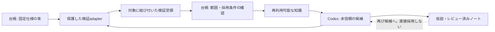

# 13 仕様・検証・知識再利用

[English](13-verified-discovery.md) | [ホーム](../README.ja.md)

**2026-11-11時点の設計案です。** schemaと合成例は接続契約であり、検証器・知識サービス・Lean連携・研究実験・性能改善の実装や実証はありません。

## 出典と読み取り

Shirobokovほか、*Discovering formally verified quantum programs with AI*、[arXiv:2611.09822v2](https://arxiv.org/abs/2611.09822v2)、v2改訂日2026-11-09（初版提出2026-11-06）。[版固定PDF](https://arxiv.org/pdf/2611.09822v2)・[HTML](https://arxiv.org/html/2611.09822v2)。参照日2026-11-11。

| 確認箇所 | 関連する知見 |
|---|---|
| §1.1–1.2、PDF pp.3–4 | Leanによる量子プログラムの正しさ・コストの証明と、柔軟なエージェント構成を組み合わせる。 |
| Appendix B、PDF p.20 | 外部検証で固定仕様、推移的な依存定義、許可公理を確認する。 |
| Appendix C、PDF pp.20–22 | 検証済み解・再利用部品と、レビュー済みアイデア・議論を区別する。 |
| §2.6–3、Code availability | 仕様の抜け穴には修正が必要。協働の寄与分離は難しく、ライブラリは公開予定と記載。 |

量子計算の資源削減は本ハーネスの測定結果ではありません。大人数化・特定モデル・形式証明が一般の実証研究を改善する証拠とは扱わず、論文のライブラリを導入済みとも仮定しません。

**以下はすべて、このリポジトリ独自の設計提案です。** 論文の実装そのものではありません。最小ワーカー基準、既存の[責務](11-harness-boundaries.ja.md)・[評価](07-evaluation.ja.md)・[受入](12-protocol-and-acceptance.ja.md)を維持します。

## 1. 固定仕様は一つの束とし、正本を増やさない

実行上限は `experiment-plan`、研究比較は `evaluation-protocol/1` の責務を維持します。[verification-contract/1](../schemas/verification-contract.schema.json)を内容ハッシュ付きのマニフェストとして追加し、別の権限機構や編集可能な重複計画にはしません。候補評価前に仕様の束をfreezeし、その後の各提出freezeで対象候補を既存の束へ結びます。新候補の提出で共通仕様を書き換えません。

仕様と依存関係全体を固定します。データ定義、分割manifest、指標変換、前処理、比較対象の意味、単位、許容差、必要な場合は定理の定義・仮定も対象です。最上位ファイル名だけでなく、不変の内容と依存関係を記録。検証環境・ツールチェーン・ポリシーは候補コードとは別に固定します。

候補が差し替え可能な箇所を列挙します。アルゴリズムは変更できても、入力生成・集計・コスト定義は変更できない、といった境界です。検証器は保護した正本を読み、候補内の同名パスやモジュールを信用しません。保護importの横取り、依存manifestの差替え、甘い検証器の選択を許しません。

freezeと版の正本は台帳です。版を受け入れられる主体は既存の許可で決まり、一律の再確認を増やしません。仕様の反例が出たら理由・影響範囲を付けて改訂し、旧結果は旧仕様に残します。新しい版で比較・採用する前に、影響する基準・候補の受領・再利用知識を再検証。仕様修正で過去の失敗を成功へ書き換えません。

## 2. 候補 → 検証器 → 受領 → 採用

1. **提出:** コード・設定・依存・主張・証拠を保存。開発時の自己検査は可能ですが、信頼する合格受領は発行できません。
2. **受付:** 台帳が許可・不変参照・差替え範囲を確認し、検証と終了処理の予算を予約。受付失敗も明示的な結果にします。
3. **検証:** 保護adapterが受入済みlock/imageと正本仕様からクリーンな環境を作り、宣言した検査だけを実行。候補とbuild hookは未信頼コードです。任意の候補設定を検証器プロセスへimportせず、候補の環境変数・plugin・認証情報・通信権限を引き継ぎません。
4. **受領:** [verification-report/1](../schemas/verification-report.schema.json)へ正確な対象・範囲・結果・証拠・限界を記録。`passed` は指定検査の成功であり、提出物の全主張が真という意味ではありません。発行者は受入済み実行境界で認証し、JSON内の名前やハッシュだけで信用しません。
5. **採用／保持:** 台帳が完全性・互換性・アクセス区分・事前定義した採用条件を確認。不合格・判断不能・無改善も費用付きで保持。検証成功だけで最良候補を置き換えません。

検証も期限・重複抑止・予算管理下のジョブです。失敗文の生成だけで自己返金・再試行できません。受領喪失時は再実行前に照合します。キャッシュは候補・契約・評価器・入力・依存・環境が完全一致し、アクセスが有効な場合のみ再利用。意図した反復は新しい試行です。最終確認・新領域での再現を、開発時のキャッシュで代用しません。

## 3. 分野別adapterと保証範囲

最初は既存試行と整合する決定論的CPU／実証検査です。Leanなどの証明支援系は、対象の主張を実際に形式化できる課題向けの後続adapterとします。引継ぎ品質の研究に量子ツールチェーンを必須化しません。

| 軸 | 根拠となるもの | 保証しないこと |
|---|---|---|
| 契約適合 | 固定入力・依存の検査、受入済み実行受領 | 仕様が科学的に適切な問いを定めていること |
| 実証検査 | 宣言した試験・測定、全結果、統計分析 | 未試験の条件も含む普遍的な正しさ |
| 形式証明 | 受入済み証明器、正確な定理・仮定・証明物、依存・公理の確認 | 物理モデルの妥当性、新規性、実測速度、全性質 |
| 再現 | 実際の担当・環境を記録した別の実行 | 新プロセスであるだけで独立科学レビューとすること |
| 研究貢献 | 文献・代替説明・適用範囲・明示レビュー | 一つの得点や証明による自動的な真偽決定 |

**上下関係ではなく独立した記録です。** 形式証明済みでも再現や有用な実測効果がない場合があります。実証結果を形式検証済みに格上げしません。将来のproof adapterでは、未許可の仮定・未完証明・定義変更・未証明コストがある主張は合格にしません。別分野の公理一覧を万能な許可リストとして流用せず、受け入れた仮定を明記します。

候補の目的コスト（遅延・誤差・メモリ・証明された資源上界）と、研究を進める費用（呼出・token・worker秒・検証・通貨）は別管理です。単位とコスト規約を契約で版固定。記号的上界の証明は実機の性能測定ではなく、安いアルゴリズムを得ても探索予算は増えません。

## 4. 未検証の主張を混ぜない知識再利用

非公開台帳へ版付きの知識索引を追加します。不変の物と受領を参照するviewであり、別の正本や共有DBではありません。公開wiki・エージェント間通信は自動作成しません。

| 種類 | 必要な根拠と使い方 |
|---|---|
| 検査済み結果 | 範囲付き受領、互換仕様、選定記録。入出力の権限が許す場合のみ新候補の出発点にする |
| 再利用部品 | 部品自体の検査済みinterface、仮定、依存、限界。統合した候補全体は別途確認 |
| レビュー済み案 | 出典、確認者、不確実性、次の判別検査。計画材料であり検証済み結果ではない |
| 条件付き否定結果 | 具体的な失敗・反例、試した範囲、環境。同じ失敗設定を避ける根拠であり、関連仮説すべての否定ではない |

各項目にID・版・種類・内容ハッシュ・親／出典・互換契約版・証拠・評価データへの接触区分・許可受信者・現在の再利用資格（`eligible`、`quarantined`、`superseded`、`revoked`）を記録。P1/P3で実装する概念契約であり、今回知識サービスはありません。

採用は台帳のみが出所と権限を確認して行います。レビュー担当は案を分類できますが、証明や測定結果に変換できません。部品の局所試験が親候補の無関係な保証を継承することもありません。依存・受領・権限が無効なら影響項目を隔離し、新しい再利用を止め、歴史的証拠は保持。復帰には互換検査が必要で、要約の書き直しで証明を修復しません。

最良候補の更新は開発用証拠だけを使います。最終holdoutの出力や答えを漏らす失敗記録は、調整用文脈・議論・sleepへ入れません。許可された最終feedbackを再利用する場合も、[12](12-protocol-and-acceptance.ja.md)に従い、接触を記録し、その評価集合を以後の確認的評価から外してから調整します。公開許可が汚染を消すわけではありません。sleepへは選別したレビュー済み教訓だけを渡し、知識採用の権限は渡しません。

## 5. 協働は必要な規模に留める

最初はワーカー1つと順次レビューです。共通契約は将来の異なる構成を可能にしますが、固定のplanner／coder／criticを必須にしません。具体的な障害に追加役が必要なら、問い・証拠範囲・予算を限定し、統合／採用の正本は一つに保ちます。

議論は項目に紐付く提案・反論を生成し、受入結果にはしません。会議や知識サービスを追加する前に、同じ単一ワーカー基準と総予算で拡張一つを比較。今回、定期会議・外部エージェント依頼・モデルprovider変更を作りません。

採用条件は開発データと事前に定めた意味のある効果／保守性で判断し、別分野の数値閾値をそのまま移植しません。小さく簡潔な成果物を残す価値と、科学的な主要指標の改善は別に説明します。

## 6. 移行と実装受入

- `design-1`、`evaluation-protocol/1`、`harness-handoff/1` は変更しません。新manifestで既存objectの正確なハッシュを参照し、旧schemaへ未定義フィールドを混ぜません。
- 過去の証拠は書き換えず閲覧可能にします。検証対象との結合がないものはlegacy／未検証とし、ワーカー報告から信頼する受領を捏造しません。
- P1は固定依存・検証記録と構造／意味検査、P2はオフライン保護検証、P3は利用可能な知識の取得。協働はP5、形式adapterはP7で必要性を測ります。[実装計画](10-roadmap.ja.md)を参照。
- 巻戻しは新規採用／再利用を無効にし、受領・予約を保存したまま受入済み単一ワーカーへ戻す操作です。自己申告合格へのfallbackはしません。

以下は**将来の実行時受入ケースで、schema検査では実施しません**。

| ID | 試料 | 観測すべき結果 |
|---|---|---|
| SCI-13 | 指標・helperの推移的定義だけ変更し、最上位名を保持 | 正本依存との不一致を拒否し、旧受領を再利用しない |
| SCI-14 | 検証器importの横取り、checker／設定の差替え | 保護環境の固定依存を使用し、差替えを拒否 |
| SCI-15 | 未許可仮定・未完証明・未証明コスト | 該当主張を不合格／非対応にし、実証試験で格上げしない |
| SCI-16 | 受入仕様・コスト規約が改訂 | 新freezeを作り、影響する基準・候補・知識を再検証するまで比較しない |
| SCI-17 | レビュー合意、自己発行受領、偽発行者で採用を要求 | 信頼する採用をせず、許可範囲で未検証ノートを保持 |
| SCI-18 | 仮定外の部品再利用、依存受領の失効 | 新利用を停止／隔離し、旧証拠は保持 |
| SCI-19 | 最終評価の答えが再利用ノートへ混入 | アクセス拒否、または接触記録と確認的利用の終了を調整前に実施 |
| SCI-20 | 検証timeout、受領喪失、意図した反復にcache使用 | 予算を保持・照合し、不完了を明示。二重実行や架空反復なし |

[設計検査](../scripts/README.ja.md)は構造整合性の確認です。成功してもSCI-01〜20の実行、定理の検証、発行者認証、DOTS実接続、研究実験の成功にはなりません。
