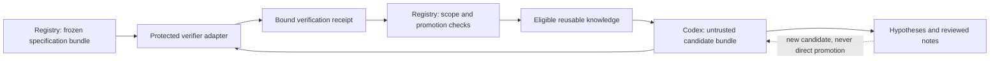

# 13 Specification, Verification and Knowledge Reuse

[日本語](13-verified-discovery.ja.md) | [Home](../README.md)

**Status: proposed design, 2026-11-11.** The schemas and fixtures describe interfaces. No verifier, knowledge service, Lean integration, research experiment or improvement has been implemented or demonstrated.

## Source and interpretation

Shirobokov et al., *Discovering formally verified quantum programs with AI*, [arXiv:2611.09822v2](https://arxiv.org/abs/2611.09822v2), v2 revised 2026-11-09 (first submitted 2026-11-06). [Versioned PDF](https://arxiv.org/pdf/2611.09822v2); [HTML](https://arxiv.org/html/2611.09822v2). Consulted 2026-11-11.

| Inspected location | Relevant finding |
|---|---|
| §1.1–1.2, PDF pp.3–4 | Quantum-program discovery combines Lean correctness/cost proofs with flexible agent teams. |
| Appendix B, PDF p.20 | External checking binds submissions to frozen specifications, including transitive definitions and allowed axioms. |
| Appendix C, PDF pp.20–22 | Checked solutions and reusable components are distinguished from reviewed ideas and discussion. |
| §2.6–3 and Code availability | Specification loopholes require correction; collaboration effects are difficult to isolate; library release is described as forthcoming. |

Reported quantum resource reductions are not measurements of this harness. The reference does not establish that a larger team, a particular model, or formal proof improves general empirical research. We do not install or assume access to its library.

**Everything below is this repository's proposed adaptation**, not an implementation supplied by the paper. Retain the minimal-worker baseline and existing [ownership](11-harness-boundaries.md), [evaluation](07-evaluation.md) and [acceptance](12-protocol-and-acceptance.md) contracts.

## 1. One frozen specification bundle, no second source of truth

Keep `experiment-plan` responsible for execution limits and `evaluation-protocol/1` responsible for scientific comparison. Add [verification-contract/1](../schemas/verification-contract.schema.json) as a content-bound manifest, not an alternative permission system or a duplicate editable protocol. Freeze the specification bundle before candidate evaluation. Each later submission freeze binds its exact candidate to that existing bundle; a new candidate does not rewrite the shared specification.

The manifest identifies the trusted specification and its dependency closure: data definitions, split manifests, metric transformations, preprocessing, baseline meaning, units, tolerances and, where applicable, theorem definitions and assumptions. Record immutable objects and the dependency relationship, not only a top-level filename. The accepted environment/toolchain and verifier policy are pinned separately from worker-produced code.

Explicitly enumerate candidate-owned replacement points. For example, an algorithm implementation may change while the benchmark's input generator, aggregation and cost conventions cannot. A checker must load protected copies; a matching path or module name in a candidate workspace is not sufficient. Candidate code cannot shadow a protected import, replace the dependency manifest or choose a more permissive checker.

The registry owns the freeze event and revision. Existing authorization determines who may accept a revision; this document introduces no blanket reconfirmation step. A counterexample to the specification opens a documented revision, with reason and impact set. Old results stay attached to the old specification. Recheck affected baselines, candidate receipts and downstream reusable entries before comparing or promoting under the new revision. Fixing the specification cannot retroactively turn a failed run into a pass.

## 2. Candidate → verifier → receipt → promotion

1. **Submit:** the worker stores candidate code/configuration, declared dependencies, claims and required evidence. It may run development checks, but cannot issue a trusted pass.
2. **Admit:** the registry resolves authorization and immutable references, reserves verification and cleanup cost, and checks the candidate's allowed replacement surface. Failure remains an explicit admission outcome.
3. **Verify:** the protected adapter reconstructs a clean environment from the accepted lock/image and trusted specification, then runs only the declared checks. Treat the candidate and its build hooks as untrusted executable input. Do not import its arbitrary configuration into the verifier process or inherit its environment variables, plugins, credentials or network access.
4. **Receipt:** [verification-report/1](../schemas/verification-report.schema.json) records exact bindings, scope, check outcome, evidence and limitations. `passed` means the specified checks passed, not that every claim in a submission is true. Authenticate the issuer through the accepted execution boundary; a JSON issuer field or content hash does not establish trust.
5. **Promote or retain:** the registry checks receipt completeness, current compatibility, access classification and the predeclared promotion rule. Keep rejected, inconclusive and non-improving candidates with their costs. A successful check does not require replacing the current best candidate.

A verification attempt is a bounded job under the existing lease/idempotency/budget rules. It cannot refund its own usage or create a retry merely by producing a failure message. A lost receipt requires reconciliation, not blind re-execution. Cache a receipt only for its exact candidate, contract, evaluator, input, dependency and environment bindings while access remains valid; an intentional replicate remains a new attempt. Final confirmation and fresh reproduction must not be replaced by a cached development result.

## 3. Domain adapters and scoped guarantees

The first adapter remains deterministic CPU/empirical checking, compatible with the existing pilot. Lean or another proof assistant is an optional later adapter for a task whose claims can actually be formalized. Do not require a quantum toolchain for handoff-quality research.

| Dimension | What can establish it | What it does not establish |
|---|---|---|
| Contract conformance | Frozen-input/dependency checks and accepted execution receipts | The specification asks the right scientific question |
| Empirical check | Declared tests/measurements, full outcomes and statistical analysis | Universal correctness outside tested conditions |
| Formal proof | Accepted proof checker, exact theorem/assumptions and proof artifacts, audited dependency/axiom policy | Physical-model fidelity, novelty, measured speed or all program properties |
| Reproduction | A separately recorded rerun with its actual operator/environment | Independent scientific review merely because the process is new |
| Research contribution | Literature, alternatives, applicability and explicit review | Automatic truth from any single score or proof |

These are **orthogonal records, not a ladder**. A formally proved property may still lack a reproduction or a useful empirical effect. An empirically supported result must never be relabeled formally verified. For a future proof adapter, unsupported axioms, incomplete proofs, changed definitions or unchecked cost claims prevent the corresponding proof claim from passing. Record the approved assumptions explicitly rather than adopting a universal allowlist from another domain.

A candidate's objective cost (latency, errors, memory, or proved algorithmic resource bound) is distinct from the research cost (calls, tokens, worker seconds, verification, currency). Version objective units and cost conventions in the contract. Matching a symbolic cost bound does not measure real hardware performance. A cheaper algorithm does not pay for extra search automatically.

## 4. Knowledge reuse without laundering unverified claims

Extend the private registry with a versioned knowledge index. This is a view over immutable objects and receipts, not another authority or a new shared database. No automatic public wiki or cross-agent communication is created.

| Entry kind | Minimum evidence / allowed use |
|---|---|
| Checked result | Scoped receipt plus compatible specification and selection record; may seed a new candidate only where input/output access permits |
| Reusable component | Its own checked interface, assumptions, dependencies and limitations; full candidate integration still needs checking |
| Reviewed idea | Source, reviewer, uncertainty and next discriminating check; planning only, never a verified result |
| Conditional negative result | Concrete failure/counterexample, attempted scope and environment; avoid the same failed configuration, not all related hypotheses |

Every entry records identity/revision, kind, content hash, parent/source references, compatible contract versions, evidence references, exposure classification, permitted recipients and current eligibility (`eligible`, `quarantined`, `superseded` or `revoked`). These are conceptual records to implement at P1/P3; there is no knowledge-store runtime in this change.

Only the registry promotes after verifying provenance and access. A reviewer can classify an idea, but cannot convert it into a proof or a measured result. A component passing local tests cannot inherit a parent candidate's unrelated guarantees. If a dependency, receipt or permission is invalidated, quarantine the affected index entries and block new reuse while retaining historical evidence. Reinstatement requires a compatible check; a new summary does not repair the old proof.

Use development evidence for the evolving best-candidate index. Final holdout outputs and answer-revealing failure notes do not enter tuning context, discussion or sleep memory. When authorized final feedback is reused, record exposure and retire that set from confirmatory use before further tuning, as in [12](12-protocol-and-acceptance.md). Publication permission does not erase contamination. Sleep exports remain selected, reviewed lessons and never the registry's promotion authority.

## 5. Keep collaboration proportionate

Start with one worker and sequential review. The shared contract permits different team arrangements later; it does not require a permanent planner/coder/critic hierarchy. When a particular blocker justifies another role, give it a bounded question, permitted evidence and budget, retaining a single merge/promotion owner.

Discussion produces proposals or challenges linked to an entry, not accepted outcomes. Before adding meetings or a knowledge service, compare one such extension against the same single-worker baseline and total budget. No periodic conference schedule, external agent request or model-provider change is created by this design.

Promotion must use development data and a declared meaningful-effect/maintenance criterion. Do not import numerical thresholds from a different research domain. A smaller or simpler artifact may be worth retaining without claiming a metric improvement; state that decision separately from the scientific endpoint.

## 6. Migration and implementation acceptance

- Preserve `design-1`, `evaluation-protocol/1` and `harness-handoff/1` unchanged. New manifests supplement their objects by exact hash; they are not added as unknown fields to old schemas.
- Inspect historical evidence without rewriting it. Mark missing verification bindings as legacy/unverified; never synthesize a trusted receipt from a worker's report.
- P1 adds frozen dependency/verification records and shape/semantic validation. P2 proves the offline protected-check boundary. P3 adds eligible knowledge retrieval. P5 may evaluate collaboration; P7 may evaluate formal adapters. See [roadmap](10-roadmap.md).
- Rollback disables new promotion/reuse and returns to the accepted single-worker configuration, preserving receipts and reservations. It never falls back to worker self-certification.

The following **future runtime acceptance cases are not executed by schema tests**:

| ID | Fixture | Required observable outcome |
|---|---|---|
| SCI-13 | Candidate changes a transitive metric/helper definition while preserving its top-level name | Trusted-closure mismatch rejected; old receipt is not reused |
| SCI-14 | Candidate shadows a verifier import or substitutes its checker/configuration | Protected environment loads its own pinned dependencies; substitution rejected |
| SCI-15 | Proof claim contains an unapproved assumption, unfinished proof or unproved cost | That claim fails or is unsupported; empirical tests cannot upgrade it |
| SCI-16 | Accepted specification/cost convention changes | New freeze; affected baseline/candidate/knowledge comparisons blocked pending compatible checks |
| SCI-17 | Reviewer agreement, worker-authored receipt or forged issuer requests promotion | No trusted promotion; unverified note retained where permitted |
| SCI-18 | Checked component reused outside its assumptions, or dependent receipt revoked | New use blocked/quarantined; historical evidence retained |
| SCI-19 | Final-answer detail enters a reusable note | Access denied or exposure recorded and final set retired before tuning |
| SCI-20 | Verification times out, receipt is lost, or cached result is used for an intentional replicate | Budget retained/reconciled; explicit incomplete result; no duplicate or fabricated repetition |

Run the repository's [design checks](../scripts/README.md) for structural consistency. Passing them does not pass SCI-01–20, validate a theorem, authenticate an issuer, establish a live DOTS connection or execute research.
