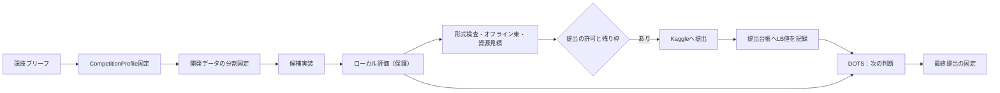

# 15 Kaggleコンペ対応：競技プロファイルと提出境界

[English](15-kaggle-competitions.md) | [ホーム](../README.ja.md)

**2026-11-16の設計案です。** 文書のみの変更で、コンペ参加・規則同意・データ取得・学習・提出・Writeup公開は行っていません。DOTS中心、単一ワーカー、固定仕様、保護した評価という既存設計を維持し、Kaggleを「主催者が評価器と最終評価を所有する研究課題」として接続します。知識とOSS候補は[16](16-kaggle-knowledge-oss.ja.md)。

## 確認範囲

2026-11-16に次の公開ページを読みました。主催者は内容を変更できるため、実行前に再確認して版（確認日）を固定します。

| 資料 | 確認した箇所 | 未確認 |
|---|---|---|
| [Gemma 4 Developer Agent](https://www.kaggle.com/competitions/gemma-4-developer-agent/overview) | Overview全節、Dataのファイル説明 | Rules本文、`HARNESS_README.md`、sample_submission、Discussion、1日の提出上限 |
| [Name That LLM](https://www.kaggle.com/competitions/name-that-llm/overview) | Overview全節、Dataのファイル説明 | Rules本文、実データ、Discussion、1日の提出上限、最終提出の選択数 |
| [Physical-Engineering's Last Exam](https://www.kaggle.com/competitions/physical-engineerings-last-exam/overview) | Overview全節、[google-research/ple](https://github.com/google-research/ple) README | Rules本文、`kit/README.md`、`docs/protocol.md`、`docs/models.md`、開発課題の中身、費用計算式、[論文](https://arxiv.org/abs/2610.30537)本文 |

Rules・Dataの閲覧には参加と規則同意が必要です。同意は利用者本人の行為で、ハーネスは代行しません。Name That LLMの対話セッション用`test.csv`は、Overviewでは1行、Dataでは3行と記載が異なります。どちらでも動く実装を要件にします。

## 三つのコンペの要約

| | Gemma 4 Developer Agent | Name That LLM | PLE Agent Harness |
|---|---|---|---|
| 形式 | 予測コンペ（エージェント設定を提出） | コードコンペ（Notebook再実行） | ハッカソン（Writeup＋GitHub commit） |
| 候補（提出物） | `submission.zip`：`agent.yaml`必須、prompt・sub-agent・ADK Skill・PEFT LoRA | 隠しtest約4,000件を読み`submission.parquet`を書くNotebook | `submission.yaml`・`serve.py`・`harness.py`・`artifacts/`・Apache-2.0／MIT `LICENSE`を含むcommit |
| 評価 | 修正patchが検証テストを通過した課題の割合（PASS／FAIL） | 18クラスのbalanced accuracy。公開／非公開でクラス構成が異なる | Stage 1：Writeup 100点で上位100。Stage 2：隠し56課題×3回の平均点と費用のPareto、平均0.138以上 |
| 開発データ | 公開129課題（fastapi、rich、requests、httpx）。参照patch・test_patch・コードグラフ・埋め込み付き | `train.csv` 2,699件、150プロンプト、`prompt_id`付き | 公開dev 29課題（Hugging Faceの制限付きデータセット） |
| 最終評価 | 非公開リポジトリ由来の約120課題。公開／非公開LBへ均等分割 | 学習に無いプロンプトの文章。40〜250語 | 隠し56課題（構造6・土木9・電気18・機械23） |
| 実行制約 | 全課題合計12時間、Gemma 4の4変種から1つ、全agentで同一base、ネットなし | CPU／GPUとも9時間以内、ネットなし、公開外部データ・事前学習モデル可 | 課題ごと2 CPU・4 GB RAM・6時間、`/opt/harness` 2 GiB以下、モデルAPI以外の通信なし、Web検索なし |
| 期限（UTC 23:59） | 参加・合流 2026-11-25、最終提出 2026-12-02 | 参加・合流 2027-01-06、最終提出 2027-01-13 | 最終提出 2027-01-05 |

Gemmaの論文トラック締切（2026-11-12）は過ぎています。小型モデル賞はE2B／E4Bをbaseにした最上位提出が対象です。

## 既存設計との対応

| Kaggleの要素 | 本ハーネスでの扱い | 正本・担当 |
|---|---|---|
| Overview・Data・Rules | TaskSpecの外部仕様。確認日とページを固定し、変更を検知したら計画を改訂 | 台帳（[14](14-sakana-lifecycle.ja.md)） |
| 公開された学習／開発データ | 開発データ。内部でさらに探索用と確認用へ分割 | 評価計画（[12](12-protocol-and-acceptance.ja.md)） |
| ローカルCV・ローカル再現評価 | 候補が変更できない開発評価器。主要な選択根拠 | 保護した評価器（[07](07-evaluation.ja.md)） |
| Public LB | 主催者所有の外部評価器が返す限定フィードバック。提出は評価器呼出枠の消費であり外部送信でもある | 提出台帳（下記） |
| Private LB・Stage 2 | 最終評価。ハーネスからは見えず、固定した候補を出すだけ | 主催者 |
| 最終提出の選択 | 選択候補の固定。締切前に規則と理由を記録 | DecisionReceipt（[14](14-sakana-lifecycle.ja.md)） |
| 1日の提出上限、Notebook時間、GPUクォータ、12時間／6時間枠 | 資源枠と評価器呼出予算 | 予算受付（[11](11-harness-boundaries.ja.md)） |
| 外部データ・事前学習モデル・OSS | 出所・ライセンス・公開可否を記録した入力 | `sources/index.json`（[03](03-architecture.ja.md)） |
| Writeup・解法公開 | 証拠付き報告。数値と図を生証拠へ解決 | 主張対応表・図manifest（[14](14-sakana-lifecycle.ja.md)） |
| チーム合流、コード共有、規則同意 | 利用者の判断と許可が必要な外部行為 | 利用者（[09](09-safety-publication.ja.md)） |

LBスコアは保護検証の受領ではありません。主催者の評価器が返した外部の測定値として、候補digest・提出時刻・返却値・不明な雑音とともに記録します。

## 追加する概念（既存wireへのフィールド追加ではない）

| 概念／正本 | 最低限の内容 | 既存との関係 |
|---|---|---|
| CompetitionProfile／台帳 | コンペID、確認した資料と確認日、提出形式、指標と方向、実行制約、期限、提出上限、外部データ条件、未確認事項 | TaskSpecの外部仕様部分。[雛形](../templates/competition-brief.ja.md)から作り、主催者の変更時に新しい版にする |
| SubmissionPackage／実装役 | 候補digest、提出形式に合わせた成果物、同梱物の一覧とサイズ、形式検査の結果 | 候補成果物の一種。評価器・検査器は候補の書込み範囲外 |
| OfflineBundle／台帳 | ネットなし実行に必要なモデル重み・wheel・データの一覧、hash、ライセンス、取得元 | 検証契約の依存閉包に対応。束に無い依存は実行時に失敗させる |
| SubmissionLedger／台帳 | 提出ごとの候補digest、ローカル評価値、提出時刻、LB返却値、残り提出枠、LBを判断に使ったか | 新しい外部評価記録。不明な提出結果は照合まで再送しない |
| FinalSelection／台帳 | 最終提出に選ぶ候補、事前定義した選択規則、理由 | DecisionReceiptの適用。締切後は変更不可として扱う |

JSON・schema・合成例は変更しません。新しい記録は後続実装で版付きschemaと意味検査を定義します。

## 提出までの流れ

1. **ローカル評価が先。** 候補の採否は固定した分割でのローカル評価で決めます。LBは確認用に少数だけ使います。
2. **提出前検査。** 形式、ID重複、欠損、許可ラベル、ファイル名、サイズ、ネットなしでの再実行、時間見積を機械的に確認します。提出枠を形式エラーで消費しません。
3. **提出は外部送信。** 許可された研究枠に「このコンペへの提出」と1日の上限が含まれる場合だけ進めます。枠外では候補と検査結果を揃えて利用者へ返します。
4. **LB値の扱い。** LBを見て調整した候補は、LBに接触した開発証拠として記録します。Public LBの順位を最終選択の唯一の根拠にしません。
5. **最終提出。** 選択規則を締切前に固定します。ローカル評価が最良の候補と、保守的で安定した候補を分けて選ぶ案を既定にします。

## コンペ別プロファイル

### Gemma 4 Developer Agent

- **候補の変更範囲。** `agent.yaml`、system prompt、sub-agent構成、ADK Skill（`SKILL.md`・scripts・resources）、サンプリング設定、LoRAアダプタ、任意の`eval_config.yaml`による課題ごとの時間上限。base modelの選択は4変種に限られ、全agentで同一です。
- **使えるツール。** `run_command`、`submit_patch`、`get_status`、`read_file`、`edit_file`、`write_file`、`get_code_neighbors`、`search_similar_code`、`get_code_subgraph`と、`agent_tool`で定義した自作sub-agentだけです。
- **ローカル評価。** 公開129課題に参照patchとtest_patchがあり、`docker/`と`sandbox/setup.py`でsandboxを再現できます。4リポジトリは公開OSSで、最終評価は非公開リポジトリ由来です。リポジトリ単位でholdoutし（例：3つで調整、1つで確認）、公開課題での正答率を最終評価の推定値として扱いません。
- **雑音。** Public LBは約60課題で、1課題が約1.7ポイントに相当します。正答率30%なら二項分布の標準誤差は約6ポイントです。数ポイントのLB差で採否を決めません。エージェントの確率的な挙動は反復で測ります。
- **予算。** 約120課題で合計12時間（sandbox準備を含む）なので、1課題あたり平均約6分です。課題ごとの時間上限、`get_status`での残量確認、打切り前の`submit_patch`を設計に入れます。
- **段階。** (a) sample_submissionを基準として記録、(b) prompt・Skill・sub-agentのみの候補、(c) LoRA。LoRA学習はGPUと学習データの許可が要る別の資源枠です。量子化済みbase（`qat-w4a16-ct`）とアダプタの互換条件は`HARNESS_README.md`で確認するまで未確認です。
- **期限。** 参加締切まで9日、最終提出まで16日（2026-11-16時点）。期間内に完了する範囲へ絞ります。

### Name That LLM

- **候補の変更範囲。** 特徴量、分類器、学習手順、アンサンブル、Notebookに同梱するモデルとwheel。
- **ローカル評価。** 2,699件÷150プロンプト÷18モデルから、各プロンプトに各モデルがほぼ1回ずつ答えた構成と推定します（実データで確認）。テストは未出プロンプトなので、`prompt_id`でグループ分割します。同じプロンプトを学習と検証の両方に入れた評価は無効です。
- **指標。** balanced accuracyはクラスごとの再現率の平均です。公開／非公開でクラス構成が異なるため、LBのクラス比へ事前確率を合わせません。fold外予測で混同行列を記録し、同一社内の近縁モデル（例：gpt-5.6-luna／sol／terra）の誤りを別に追います。
- **実行制約。** ネットなし・9時間以内。モデル重みとwheelはKaggle Dataset／Modelとして添付します。隠しtest約4,000件での推論時間を事前に見積り、1〜3行のtestでも4,000行でも動くことを確認します。
- **段階。** (a) CPUだけで動く文字n-gram＋線形分類器、(b) 文体特徴とGBDTのスタッキング、(c) エンコーダやLoRA付きLLM分類器（GPU枠が必要）。(a)は既存設計の「CPU一周」にそのまま当てはまり、最初の完全な一周に適します。
- **外部データ。** 「無償で公開されたデータ・事前学習モデル」は許可されています。対象18モデルをAPIで呼んで追加学習データを作ることが規則に合うかは未確認で、Rulesと主催者の回答を確認するまで行いません。

### PLE Agent Harness

- **候補の変更範囲。** 独立したGitHubリポジトリに置くエージェントハーネス本体（`serve.py`・`harness.py`）、検証ループ、ツール連携、文脈管理、使用モデル。**本リポジトリは提出物ではなく、その開発と比較実験を統括する研究ハーネスです。** 本リポジトリにLICENSEファイルが無いことは提出物の要件と別問題です。
- **実行形態。** ハーネスはWebSocketサーバとして課題コンテナの横で動き、JSONプロトコルでシェル実行・ファイル読み書き・課題ごとのローカルMCPサーバ（文書、表計算、メール、CAD）呼出を行います。`serve`は120秒以内に`0.0.0.0:$PORT`へbindし、終了時に`done`か`error`を送ります。どちらも無い打切りは0点です。
- **ローカル評価。** `uv run python -m kit check`、`eval/run.py`、`kit artifacts`。dev 29課題は少数なので、課題単位の対応差と3回以上の反復で比較します。ローカルの判定モデルが公式（Claude Opus 5.5）と異なる場合はWriteupに明記する必要があり、主催者は`artifacts/`を公式judgeで再採点します。
- **Stage 1の採点基準との対応。** 失敗分析と統制したablation（25点）、技術者の手順との比較（25点）、2モデル以上での比較（15点）、得点と計算量の関係（20点）、明瞭さと図（15点）。既存設計の「一変更の比較」「全結果の保存」「費用の記録」「主張対応表と図manifest」がそのまま成果物になります。必須の3図（構成図、得点対費用、dev 29課題の失敗内訳）は図manifestから生成元runへ解決します。
- **Stage 2。** 順位は平均点で、Pareto前線上にあることが入賞条件です。HTTP 400、回復しないクラッシュ、時間切れは減点になります。費用を主要指標の一つとして毎runで記録します。
- **禁止事項。** 出力のハードコードは失格です。dev課題の答えを提出物へ埋め込まず、`artifacts/`は`eval/run.py`の実出力だけにします。
- **モデル。** 提出は8つの`google-cloud/*`から1つ。ローカル開発は自前のモデルや個人APIでもよく、その利用枠は別の資源許可です。

## 優先順位の提案

| 順 | 対象 | 理由 | 最初の一周 |
|---|---|---|---|
| 1 | 利用者の判断 | Gemmaの参加締切は2026-11-25。規則同意は本人のみ可能 | 3コンペの参加可否と資源枠を[競技ブリーフ](../templates/competition-brief.ja.md)へ記入 |
| 2 | Name That LLM | CPUだけで基準から評価まで一周でき、既存のP2〜P4に最も近い | グループ分割CV→文字n-gram基準→形式検査→許可があれば1回提出 |
| 3 | Gemma 4 Developer Agent | 期限が最も近い。期間内はprompt・Skill中心に絞る | sample_submissionのローカル再現→リポジトリholdoutでの比較 |
| 4 | PLE Agent Harness | 期間が長く、採点基準が本設計の比較・証拠管理と一致する | sample_submissionで`kit check`→dev数課題の失敗分類 |

これは提案で、参加・資源配分は利用者が決めます。3件を同時に走らせる場合も、実装ワーカーは一度に1つ、台帳書込みは1主体という制約を保ちます。

## 規則と許可

- 規則同意、チーム合流、提出、Writeup公開、GitHubリポジトリの公開、PLE用GitHub Appの導入は、それぞれ具体的な許可が必要な外部行為です。設計文書の作成からは推定しません。
- 1人1アカウント、チーム外との非公開コード共有の禁止、提出上限などの一般的な規則は、各コンペのRulesで確認してからプロファイルへ記入します。
- 外部データ・モデル・OSSは、ライセンスと「無償で公開」の条件を満たす記録がある項目だけ候補へ入れます。
- 自動化ツールやAIエージェントの利用条件はRulesで確認します。確認前に自動提出を有効にしません。
- Kaggleの認証情報（`kaggle.json`、APIトークン）とHugging Faceトークンは実装ワーカーの作業領域と公開リポジトリの外に置きます。
- L4×4 GPUはGemmaコンペに添付したNotebook専用で、クォータを2倍消費します。他の用途に使いません。

## 受入ケース KGL-01〜10（未実施）

設計上の受入条件で、今回は実行していません。SCI-01〜20への追加です。

| ID | 条件 | 期待 |
|---|---|---|
| KGL-01 | 不正な提出物（範囲外ラベル、ID重複、null、列欠落、誤ったファイル名、`agent.yaml`欠落、提出ルート外へのパス、base model混在、`kit check`失敗） | 提出前検査が拒否し、提出枠を消費しない |
| KGL-02 | ネットワークを遮断した再実行 | OfflineBundleだけで完走。束に無い依存は明示的に失敗 |
| KGL-03 | 時間・メモリ・サイズ上限の超過、1〜3行のtestと全量test | 超過は失敗として記録。両方の入力規模で完走 |
| KGL-04 | 同じ`prompt_id`やリポジトリが学習と検証の両方にある分割 | 評価計画の受付が拒否 |
| KGL-05 | 提出結果が不明なままの再送、1日の上限超過 | 照合まで再送せず、上限を超えない。全提出が候補digestへ対応 |
| KGL-06 | 許可の無い提出・規則同意・公開の依頼 | 実行せず、準備済みの成果物と未決事項を返す |
| KGL-07 | LB値を見た後の候補変更 | LB接触として記録され、確認的主張に使えない |
| KGL-08 | 締切前の最終選択 | 事前定義した規則・候補digest・理由が記録され、締切後の差替えを拒否 |
| KGL-09 | Writeupの数値・図 | すべて生証拠へ解決。語数、必須図、commit SHAの一致を検査 |
| KGL-10 | ライセンス・公開条件の記録が無い外部データ／モデル／OSS | 候補とOfflineBundleから除外 |

## 巻戻し

Kaggle対応は任意のプロファイルです。問題があれば提出を止め、提出台帳と証拠を保存したまま、既存の単一ワーカーによるローカル研究へ戻ります。LB値だけを根拠にした自己申告の採用へは戻りません。
