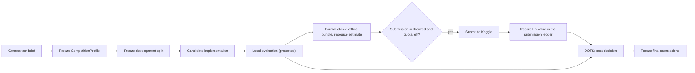

# 15 Kaggle Competitions: Competition Profiles and the Submission Boundary

[日本語](15-kaggle-competitions.ja.md) | [Home](../README.md)

**Status: proposed design, 2026-11-16.** Documentation only: no competition was joined, no rules were accepted, and no data download, training, submission or Writeup publication took place. The DOTS-centered, single-worker, frozen-specification and protected-evaluation design is preserved. Kaggle is connected as "a research task whose evaluator and final holdout belong to the host". Knowledge and OSS candidates are in [16](16-kaggle-knowledge-oss.md).

## Source coverage

The public pages below were read on 2026-11-16. Hosts can change them, so re-check before execution and freeze the revision (inspection date).

| Source | Inspected | Not inspected |
|---|---|---|
| [Gemma 4 Developer Agent](https://www.kaggle.com/competitions/gemma-4-developer-agent/overview) | All Overview sections; Data file descriptions | Rules text, `HARNESS_README.md`, sample_submission, Discussion, daily submission limit |
| [Name That LLM](https://www.kaggle.com/competitions/name-that-llm/overview) | All Overview sections; Data file descriptions | Rules text, the data itself, Discussion, daily submission limit, number of final selections |
| [Physical-Engineering's Last Exam](https://www.kaggle.com/competitions/physical-engineerings-last-exam/overview) | All Overview sections; [google-research/ple](https://github.com/google-research/ple) README | Rules text, `kit/README.md`, `docs/protocol.md`, `docs/models.md`, dev task contents, cost formula, [paper](https://arxiv.org/abs/2610.30537) body |

Reading Rules and Data requires joining and accepting the rules. Acceptance is the owner's own act; the harness does not perform it. For Name That LLM, the interactive `test.csv` is described as one row in Overview and three rows in Data; the implementation must run on either.

## The three competitions

| | Gemma 4 Developer Agent | Name That LLM | PLE Agent Harness |
|---|---|---|---|
| Format | Prediction competition (submit an agent config) | Code competition (notebook rerun) | Hackathon (Writeup + GitHub commit) |
| Candidate (submission) | `submission.zip`: required `agent.yaml`, prompts, sub-agents, ADK Skills, PEFT LoRA | A notebook that reads ~4,000 hidden test passages and writes `submission.parquet` | A commit with `submission.yaml`, `serve.py`, `harness.py`, `artifacts/` and an Apache-2.0/MIT `LICENSE` |
| Evaluation | Share of tasks whose patch passes the validation tests (PASS/FAIL) | 18-class balanced accuracy; class mix differs between public and private | Stage 1: 100-point Writeup, top 100 advance. Stage 2: performance-cost Pareto over mean score on 56 hidden tasks × 3 runs, mean ≥ 0.138 |
| Development data | 129 public tasks (fastapi, rich, requests, httpx) with reference patch, test_patch, code graphs and embeddings | `train.csv`: 2,699 passages, 150 prompts, with `prompt_id` | 29 public dev tasks (gated Hugging Face dataset) |
| Final evaluation | ~120 tasks curated from private repositories, split evenly between public and private LB | Passages for prompts absent from train; 40–250 words | 56 hidden tasks (6 structural, 9 civil, 18 electrical, 23 mechanical) |
| Runtime constraints | 12 hours total for all tasks, one of four Gemma 4 variants, same base for every agent, no internet | ≤ 9 hours CPU or GPU, no internet, public external data and pretrained models allowed | Per task 2 CPUs, 4 GB RAM, 6 hours; `/opt/harness` ≤ 2 GiB; no network except the model API; no web search |
| Deadlines (23:59 UTC) | Entry/merger 2026-11-25, final submission 2026-12-02 | Entry/merger 2027-01-06, final submission 2027-01-13 | Final submission 2027-01-05 |

The Gemma paper-track deadline (2026-11-12) has passed. The small-model bonus goes to the highest-ranking submission based on E2B or E4B.

## Mapping to the existing design

| Kaggle element | Treatment in this harness | Authority |
|---|---|---|
| Overview, Data, Rules | External specification of the TaskSpec. Freeze inspection date and page; revise the protocol when a change is detected | Registry ([14](14-sakana-lifecycle.md)) |
| Public training/development data | Development data, further split internally into search and confirmation parts | Evaluation protocol ([12](12-protocol-and-acceptance.md)) |
| Local CV / local reproduction of scoring | Development evaluator the candidate cannot modify; the main basis for selection | Protected evaluator ([07](07-evaluation.md)) |
| Public LB | Limited feedback from a host-owned external evaluator. A submission consumes evaluator-call budget and is also an external transmission | Submission ledger (below) |
| Private LB / Stage 2 | Final evaluation. Invisible to the harness; only a frozen candidate is handed over | Host |
| Choice of final submissions | Freezing the selected candidate; rule and reason recorded before the deadline | DecisionReceipt ([14](14-sakana-lifecycle.md)) |
| Daily submission limit, notebook time, GPU quota, 12-hour/6-hour envelopes | Resource envelope and evaluator-call budget | Budget admission ([11](11-harness-boundaries.md)) |
| External data, pretrained models, OSS | Inputs with recorded provenance, license and public availability | `sources/index.json` ([03](03-architecture.md)) |
| Writeup / solution write-up | Evidence-backed report; numbers and figures resolve to raw evidence | Claim map and figure manifest ([14](14-sakana-lifecycle.md)) |
| Team merger, code sharing, rule acceptance | External acts that need the owner's decision and authorization | Owner ([09](09-safety-publication.md)) |

A leaderboard score is not a protected verification receipt. Record it as an external measurement returned by the host's evaluator, together with candidate digest, submission time, returned value and unknown noise.

## Additive concepts, not new wire fields

| Concept / owner | Minimum content | Relation to existing objects |
|---|---|---|
| CompetitionProfile / registry | Competition ID, inspected sources and dates, submission format, metric and direction, runtime constraints, deadlines, submission limit, external-data conditions, unknowns | External-specification part of the TaskSpec. Created from the [template](../templates/competition-brief.md); a host change produces a new revision |
| SubmissionPackage / implementer | Candidate digest, artifacts in the required format, bundled-content list and size, format-check outcome | A kind of candidate artifact. Evaluator and checker stay outside candidate write scope |
| OfflineBundle / registry | Model weights, wheels and data needed for a no-internet run, with hashes, licenses and origins | Corresponds to the dependency closure of the verification contract. A dependency missing from the bundle fails at run time |
| SubmissionLedger / registry | Per submission: candidate digest, local score, time, returned LB value, remaining quota, whether the LB informed a decision | New external-evaluation record. An unknown submission outcome is reconciled before any resend |
| FinalSelection / registry | Candidates chosen as final submissions, predeclared selection rule, reason | Application of the DecisionReceipt; treated as immutable after the deadline |

No JSON, schema or fixture changes are made. New records need versioned schemas and semantic checks in a later implementation change.

## Path to a submission

1. **Local evaluation comes first.** Candidates are accepted or rejected on the frozen local split. The leaderboard is used sparingly, for confirmation.
2. **Pre-submission checks.** Format, duplicate IDs, nulls, allowed labels, file name, size, a no-internet rerun and a time estimate are checked mechanically. Submission quota is not spent on format errors.
3. **A submission is an external transmission.** It proceeds only when the authorized research envelope names this competition and a daily limit. Otherwise the candidate and its check results are returned to the owner.
4. **Leaderboard values.** A candidate tuned after seeing the LB is recorded as LB-exposed development evidence. Public LB rank is never the sole basis for final selection.
5. **Final submissions.** The selection rule is frozen before the deadline. The default proposal is to choose the best candidate by local evaluation and, separately, a conservative stable candidate.

## Per-competition profiles

### Gemma 4 Developer Agent

- **Candidate scope.** `agent.yaml`, system prompts, sub-agent layout, ADK Skills (`SKILL.md`, scripts, resources), sampling configuration, LoRA adapters, and optional per-task time limits in `eval_config.yaml`. The base model is one of four variants and identical for every agent.
- **Available tools.** Only `run_command`, `submit_patch`, `get_status`, `read_file`, `edit_file`, `write_file`, `get_code_neighbors`, `search_similar_code`, `get_code_subgraph`, plus custom sub-agents defined via `agent_tool`.
- **Local evaluation.** The 129 public tasks include reference patches and test patches, and `docker/` with `sandbox/setup.py` reproduces the sandbox. The four repositories are public OSS while the final evaluation comes from private repositories. Hold out by repository (for example tune on three, confirm on one) and do not treat the public-task pass rate as an estimate of the final score.
- **Noise.** The public LB has about 60 tasks, so one task is about 1.7 points. At a 30% pass rate the binomial standard error is about 6 points. Do not accept or reject on LB differences of a few points. Measure the agent's stochastic behaviour with replicates.
- **Budget.** About 120 tasks in 12 hours total, sandbox setup included, means about 6 minutes per task on average. Design in per-task limits, budget checks through `get_status`, and a `submit_patch` before cutoff.
- **Stages.** (a) Record sample_submission as the baseline, (b) candidates that change only prompts, Skills and sub-agents, (c) LoRA. LoRA training is a separate resource envelope needing GPU and training-data authorization. Adapter compatibility with the quantized base (`qat-w4a16-ct`) is unverified until `HARNESS_README.md` is read.
- **Deadline.** Nine days to the entry deadline and sixteen to the final submission as of 2026-11-16. Scope the work to what completes in that window.

### Name That LLM

- **Candidate scope.** Features, classifiers, training procedure, ensembling, and the models and wheels bundled with the notebook.
- **Local evaluation.** 2,699 passages ÷ 150 prompts ÷ 18 models suggests each model answered each prompt about once (confirm on the data). Test prompts are unseen, so split by `prompt_id` groups. An evaluation with the same prompt in both train and validation is invalid.
- **Metric.** Balanced accuracy is the mean of per-class recall. The class mix differs between public and private, so do not fit priors to the LB class ratio. Record the out-of-fold confusion matrix and track errors among closely related models of one lab (for example gpt-5.6-luna/sol/terra) separately.
- **Runtime constraints.** No internet, ≤ 9 hours. Model weights and wheels are attached as Kaggle Datasets/Models. Estimate inference time on ~4,000 hidden passages beforehand, and confirm the notebook runs on a 1–3 row test as well as 4,000 rows.
- **Stages.** (a) CPU-only character n-grams with a linear classifier, (b) stylometric features and GBDT stacking, (c) encoders or LoRA LLM classifiers (GPU envelope required). Stage (a) fits the existing "one CPU loop" directly and suits the first complete loop.
- **External data.** "Freely and publicly available data and pretrained models" are allowed. Whether generating extra training data by calling the 18 target models through APIs complies is unverified; do not do it until Rules and host answers are checked.

### PLE Agent Harness

- **Candidate scope.** The agent harness itself (`serve.py`, `harness.py`) in a separate GitHub repository, its verification loops, tool integrations, context management and model choice. **This repository is not the submission; it is the research harness that coordinates its development and comparative experiments.** The absence of a LICENSE file here is separate from the submission's license requirement.
- **Execution model.** The harness runs as a WebSocket server beside the task container and uses a JSON protocol to run shell commands, read and write files, and call per-task local MCP servers (documents, spreadsheets, email, CAD). `serve` must bind `0.0.0.0:$PORT` within 120 seconds and finish with `done` or `error`; a cutoff with neither scores 0.
- **Local evaluation.** `uv run python -m kit check`, `eval/run.py`, `kit artifacts`. With only 29 dev tasks, compare using per-task paired differences and at least three replicates. A local judge model other than the official one (Claude Opus 5.5) must be disclosed in the Writeup; organizers re-score `artifacts/` with the official judge.
- **Fit with the Stage 1 rubric.** Failure analysis and controlled ablations (25), comparison with an engineer's workflow (25), comparison on two or more models (15), score versus compute (20), clarity and figures (15). The existing "single-change comparison", "retain all outcomes", "record cost" and "claim map and figure manifest" become the deliverables directly. The three required figures (architecture, score versus cost, failure breakdown on the 29 dev tasks) resolve through the figure manifest to their source runs.
- **Stage 2.** Ranking is by mean score, and being on the Pareto frontier is a prize condition. HTTP 400s, unrecovered crashes and timeouts count against the score. Record cost on every run as a primary metric.
- **Prohibited.** Hard-coded outputs are disqualifying. Never embed dev-task answers in the submission; `artifacts/` holds only real `eval/run.py` output.
- **Models.** The submission uses one of eight `google-cloud/*` models. Local development may use a self-hosted model or personal API, which is a separate resource authorization.

## Proposed order

| Order | Item | Reason | First loop |
|---|---|---|---|
| 1 | Owner decisions | Gemma entry closes 2026-11-25; only the owner can accept rules | Fill participation and resource envelope for the three competitions in the [competition brief](../templates/competition-brief.md) |
| 2 | Name That LLM | Baseline through evaluation runs on CPU alone; closest to existing P2–P4 | Group-split CV → character n-gram baseline → format check → one submission if authorized |
| 3 | Gemma 4 Developer Agent | Nearest deadline; within the window, limit to prompts and Skills | Reproduce sample_submission locally → compare under repository holdout |
| 4 | PLE Agent Harness | Longer window; rubric matches this design's comparison and evidence handling | `kit check` on a sample submission → classify failures on a few dev tasks |

This is a proposal; participation and resource allocation are the owner's decisions. Even with three competitions in progress, keep one implementation worker active at a time and one registry writer.

## Rules and authorization

- Accepting rules, merging teams, submitting, publishing a Writeup, making a GitHub repository public and installing the PLE GitHub App are each external acts needing specific authorization. None is inferred from writing this design.
- General rules such as one account per person, no private code sharing outside the team and submission limits are entered in the profile only after checking each competition's Rules.
- External data, models and OSS enter a candidate only with a record that license and "freely and publicly available" conditions are met.
- Conditions on automated tools and AI agents are checked in the Rules. Automatic submission stays disabled until then.
- Kaggle credentials (`kaggle.json`, API token) and Hugging Face tokens stay outside the implementation worker's workspace and the public repository.
- L4×4 GPUs are restricted to notebooks attached to the Gemma competition and consume quota at twice the rate. Do not use them for anything else.

## Acceptance cases KGL-01–10 (not executed)

Design acceptance conditions, not run in this change. They add to SCI-01–20.

| ID | Condition | Expected |
|---|---|---|
| KGL-01 | Invalid submission (out-of-set label, duplicate ID, null, missing column, wrong file name, missing `agent.yaml`, path outside the submission root, mixed base models, failing `kit check`) | Pre-submission check rejects it; no quota consumed |
| KGL-02 | Rerun with the network blocked | Completes from the OfflineBundle alone; a dependency missing from the bundle fails explicitly |
| KGL-03 | Time, memory or size limit exceeded; 1–3 row test and full-size test | Overrun recorded as failure; both input sizes complete |
| KGL-04 | A split with the same `prompt_id` or repository in both train and validation | Rejected by evaluation-protocol admission |
| KGL-05 | Resend while a submission outcome is unknown; daily limit exceeded | No resend before reconciliation; limit not exceeded; every submission maps to a candidate digest |
| KGL-06 | Request to submit, accept rules or publish without authorization | Not performed; prepared artifacts and open items returned |
| KGL-07 | Candidate changed after seeing an LB value | Recorded as LB-exposed; unusable for confirmatory claims |
| KGL-08 | Final selection before the deadline | Predeclared rule, candidate digests and reason recorded; replacement after the deadline rejected |
| KGL-09 | Numbers and figures in the Writeup | All resolve to raw evidence; word count, required figures and commit SHA match are checked |
| KGL-10 | External data/model/OSS without a license and availability record | Excluded from the candidate and the OfflineBundle |

## Rollback

Kaggle support is an optional profile. On a problem, stop submitting, retain the submission ledger and evidence, and return to local research with the existing single worker. Never fall back to self-certified acceptance based on LB values alone.
